# 把 DAPO 从大模型搬进晶圆厂：MDP-DAPO 研究进展记录

> 写在前面：我们完成了把 LLM 强化学习的训练稳定技术（DAPO 四组件）系统性迁移到半导体产线动态抽检决策的合成仿真阶段。经过五轮迭代，锁定主推配置 **PPO+C1+C4**。本文是整个过程的长文复盘：先总述最新成果，再按 V1→V6.2 逐版讲解，随后补充"地基"——仿真环境与数据集详解、数学公式原理教学，最后总结并给出下一阶段计划。

---

## 〇、总览：我们现在站在哪里

### 这个研究在做什么

晶圆制造中，缺陷抽检率（Sampling Rate, SR）是一个经典的权衡：检得越多，缺陷发现越早、良率越稳，但计量机台负载越重、产能越受损。我们的前作（V0）用 PPO 在六维状态 {GSI 全局稳定性指数, H 健康度, L 负载, D 缺陷率, PR 产品优先级, SR 当前抽检率} 的流式 MDP 上学习动态抽检策略，动作只有三档：{下调, 保持, 上调}。

与此同时，字节跳动 Seed 与清华 AIR 提出的 **DAPO**（arXiv:2503.14476）在大模型 RL 训练中用四个组件治四种病：熵坍缩、零梯度样本、梯度稀释、截断奖励噪声。我们的核心假设是：**LLM-RL 的训练病理与工业流式 MDP 的训练病理是同构的**——

| LLM-RL 的病理 | 产线 MDP 的同构病理 |
|---|---|
| 熵坍缩（策略过早确定化） | 抽检率策略驻留在 0% 或 100% 边界 |
| 长链信号被稀释 | 高风险长轨迹中的关键决策信号被稀释 |
| 全对/全错提示零梯度 | 平稳工况"垃圾时间"产生零信号样本 |
| 超长截断污染奖励 | SR=100% 处硬截断造成奖励归因偏差 |

如果同构成立，DAPO 的四味药就能移植成 MDP-DAPO 的四组件：C1 解耦裁剪、C2 步级损失归一、C3 动态分组采样、C4 边界信任奖励塑形（完整系统架构图见第八章 Fig. 1；公式的逐条教学见第十章）。

### 最新的核心成果（V6.2 封版口径）

在重标定后的 V2.3 合成仿真器上（8 训练种子 × 配对留出评测流，500 步确定性评测），主结果如下：

| 配置 | Reward ↑ | GSI ↓ | 负载 L | 平均 SR |
|---|---|---|---|---|
| Vanilla PG | 0.0765 ± 0.0091 | 0.257 | 0.829 | 84.9% |
| A2C‡ | 0.0819 ± 0.0170 | 1.566 | 0.608 | 51.6% |
| CEM | 0.0830 ± 0.0151 | 0.860 | 0.609 | 50.0% |
| PPO（V0 基线） | 0.0825 ± 0.0151 | 0.968 | 0.611 | 53.5% |
| **PPO+C1+C4（主推配置）** | **0.0991 ± 0.0121** | 2.518 | **0.388** | 34.2% |
| PPO-DAPO（全量） | 0.0876 ± 0.0195 | 1.837 | 0.480 | 39.9% |
| GRPO-DAPO（去 critic） | −0.1460 ± 0.2309 | 796.2 | 0.375 | 30.9% |
| Static 30%（最优静态） | 0.0934 ± 0.0192 | 3.047 | 0.366 | 30.0% |
| Static 50%（产线惯例） | 0.0830 ± 0.0151 | 0.860 | 0.609 | 50.0% |

（‡ A2C 分数略低于 PPO，但因 8 个种子中有 3 个 SR 越界离群（21.3/41.5/99.8%）被排除出"非坍缩"集合——判定口径：8 个种子的均值 SR 全部落在 (25%, 75%) 内。）

凝练成六句话，每句都钉在证据上：

1. **主推配置 PPO+C1+C4 以 reward 0.0991 胜出**，比 PPO 高 20.1%、比产线惯例 Static 50% 高 19.4%（配对 Wilcoxon 名义显著 p=0.0234，未校正；Holm 多重校正后 p=0.14，我们如实降级表述）；数值上超过一切静态抽检率，但对最优静态（30%）的 +6.1% 优势在 n=8 下不显著（p=0.74）——这句话也如实写了。
2. **组件归因清晰**：C4b（软边界惩罚，目标修正）是承重墙；C4a（截断噪声掩蔽，估计修正）单独使用反而退化；C1 在默认更新体制下不激活（激进体制下保熵）；**C3（动态采样）在合成 benchmark 上是净负贡献**，机制查明为过度过滤——这是负面结果，我们没有藏。
3. **critic 不可去**：critic-free 的 GRPO-DAPO 在 8 个种子中 4 个灾难性坍缩（reward 为负、GSI 均值 796）。
4. **增益的适用范围被精确定价**：激进调参的裸 PPO（lr 1e-3, 8 epochs）能追平主推配置（0.0987 vs 0.0991, p=0.74），但代价是调参成本和约 1.5 倍的种子 std（约 2.2 倍方差）。所以我们的主张是：**DAPO 组件的增益是默认/保守更新体制下的免调参结果**——它回答的是"什么时候需要这些组件"，而不是"这些组件永远更好"。
5. **事件适应性是真实存在但被训练预算门控的后发能力**：160k 步时策略从未选择过升档（P(up|D>0.25)=0.000，功能上等价于静态 30–35% 工作点），300k 步涌现 +49.8pp 的响应幅度，500k 步达到 +60.8pp 且响应延迟仅约 2.4 步。
6. **风险语言可桥接**：reward 最优区天然风险耐受（GSI 2.52，约为 Static 50% 的 3 倍）；加一个单侧 GSI 水位惩罚（λ_G=0.5）可把 GSI 压到 0.61，代价是 reward 降到 0.0889——risk-first 是可以买的，且有明确标价。

**为什么值得读完这篇长文**：上面每个数字都不是一次跑出来的。它们是五轮模拟评审把叙事一寸寸钉回证据的产物——期间我们发现过基线控制器的 float32 bug、送审图与 run 数据双重错位、表格跨实验代际誊抄。每一轮评审的原始意见（A 类阻断项 / B 类重要项）我们都将在对应章节原文呈现。这个项目的价值一半在算法结论，另一半在"一篇论文如何从'看起来对'变成'查得出来对'"的全过程记录。下面按 V1 → V6.2 的顺序讲。

---

## 一、V1：管线打通，然后立刻撞上第一次危机

最初阶段的任务很朴素：把"训练 → 评测 → Excel 宽表 → 可视化"的全管线在 Windows + CPU 上跑通。技术上确实跑通了——MLP actor-critic（6→64→64）、四组件的工业翻译全部落地为可单测的代码（`dapo/components.py`，8 个组件单测至今全绿）。

其中最值得说的设计是 **C3 动态分组采样的"环境分叉"**：单产线流式环境没有 LLM 那种天然的"组"（同一提示的多条回答），我们的做法是深拷贝当前环境全状态（在制品、健康度、缺陷、SR/PR、拥塞、excursion 标志）成 G=8 份，各自独立随机地往前滚 T=128 步。组内共享状态起点、经历独立随机未来——这正是 GRPO/DAPO 需要的组语义，且不重置产线。组内奖励标准差 σ_g < τ=0.05 判为零信号组，从策略损失中屏蔽并过采样替补。

C4 则被拆成两半，这个拆分后来被证明是决定性的：

- **C4a 截断噪声掩蔽**：SR=100% 时"up"动作被硬截断为"hold"，观测奖励反映的是 hold 却记在 up 头上——纯估计偏差，从策略损失屏蔽（保留在价值损失）；
- **C4b 软边界惩罚带**：|SR−0.5|>0.4 起线性惩罚（δ=0.1, η=0.1），把不连续的硬钳制换成可定价的坡。

但 V1 的仿真器随即暴露了致命问题：**一个恒定的静态 50% 抽检率就能"解掉"整个环境**。在一个"无事件、检测完美、缺陷无逃逸成本"的环境里，策略学不学无所谓——benchmark 太平凡，一切方法对比都没有信息量。这是全项目第一条方法论教训：

> **Benchmark 的平凡性检验必须先于一切方法学结论。V1 的全部"结果"实际毫无信息量。**

## 二、V2：把仿真器重标定到"静态解失效"

V2 的主线是让 benchmark 配得上方法。五个机制全部冲着"让静态解失效"去（完整数学规格见第九章）：

1. **不完美检测**：设备被检出的概率 = SR × 0.6——抽检率不再是免费的确定性收益；
2. **缺陷逃逸成本**：−κ·D·(1−SR)，κ=0.3——漏检直接定价为良率损失；
3. **优先级耦合风险**：−ω5·PR·D·(1−SR)——关键产品期漏检更贵；
4. **计量拥塞**：产能因子 c_t ∈ {0.5, 1} 马尔可夫切换——高负载有时物理上不可行；
5. **持续性整厂 excursion**：p=0.005/步触发，缺陷持续上涨直到"检出→维护"清除——给"事件响应能力"预留的考题。

配套一个 **oracle 检验**：手工响应式策略（D>0.25 → SR 90%，否则 30%）拿到 reward 0.0952，高于一切静态速率（最优静态 30%：0.0934）。这证明了"没有恒定 SR 是最优的、适应性在目标函数里有正价值"。注意我们自始至终只称其为 *oracle evidence* 而非上界——后来学到的 PPO+C1+C4（0.0991）反超了 oracle，证明这个谨慎是对的。

## 三、V3：SHAP 从展示升级为诊断

方法数学体系（统一目标函数的 boxed 公式）、主表、消融、训练动力学四图、SHAP 对比图。

SHAP 是 V0 留下的可解释性资产，这一轮我们把它从"特征重要性展示"升级为**策略健康诊断**：坍缩策略与传感策略的归因指纹完全不同——PPO 的归因弱而散（边界饱和策略不读传感器），DAPO 变体的归因强且集中于 SR/L/D（策略确实在读工况）。这个"归因指纹"视角在 V6.2 里最终定型为一句更克制的话：**SHAP 证明策略在"感知"（sensing），但不证明它会"反应"（response）**——后者要靠注入事件实验来验证。

## 四、V4：消融拆弹与两个灾难样本

### 4.1 评审

第一轮评审给出 4 个 A 类阻断项、7 个 B 类重要项。

> **A1. 证明学到的不是"静态中点策略"**
> - 补静态基线：fixed SR ∈ {10%, 30%, 50%, 70%, 90%} 各跑 3 种子评测，加入 Table I。
> - 补扰动响应实验：在评测流中人为注入 defect burst 和产品优先级切换，画出 PPO-DAPO 的 SR 响应曲线，证明策略能离开 50%、事件结束后能回来。
> - 若静态 50% 性能 ≈ PPO-DAPO，则**重写问题动机**：承认当前仿真器被静态策略解出，重新标定仿真器难度，全部实验重跑。
>
> **A2. 分离 C4(a) 与 C4(b) 的消融**
> - Table II 增加两行：**PPO+C4(a)-only**（只掩码截断样本，不加软罚带）与 **PPO+C4(b)-only**。
> - 改写归因结论：25–40% 截断噪声这个"噪声源叙事"只有在 C4(a)-only 能恢复大部分增益时才成立；若增益主要来自 C4(b)，则把论文主 claim 从"估计器纠偏"降级为"目标修正 + 纠偏"。
>
> **A3. 排查三处数据疑点**
> - A2C 与 Vanilla PG 在种子 42/44 的 GSI 完全相同（3919.7 / 3614.9）：核查评测脚本是否产物复用，或确认两算法确实坍缩到同一平凡策略；
> - GRPO-DAPO 最佳种子 GSI = 0.00：核查是四舍五入、度量口径还是仿真器 bug；
> - Fig. 1 初始 SR 不一致：同一 held-out 流初始状态必须一致。
>
> **A4. 补齐 PPO 的 per-seed 数据**——本文以"PPO 双态、我方低方差"为核心卖点，唯独缺它的 per-seed 数，审稿人必然追问。

B 类包括：统一组件编号（B1）、训练种子 3→8 并报告置信区间（B2）、补风险/成本权衡讨论（B3）、讨论奖励设计与主指标的耦合（B4）、修复文献（B5）、修复图文一致性（B6）、补完整 Algorithm 1 伪代码与仿真器附录（B7）。评审的执行顺序建议也很犀利："**先做 A3**——如果评测流程有 bug，后面所有实验都要重跑"；并留下一句话总评："稿件的诚实度和结构已经是投稿级，现在缺的是**证据链闭环**。"

### 4.2 处置与两个灾难样本

这一轮发现了两个贯穿后续所有版本的主题。

**主题一：C4a-only 退化（回应 A2）。** 只做截断噪声掩蔽、不定价边界驻留，策略直接冲向 SR≈97% 近全检——GSI 0.022 全场最优（检得最多当然缺陷最少），但 reward 0.0758 崩塌（负载代价压垮一切）。结论：**"去偏"单独使用只是加速了冲向边界**；估计修正（C4a）必须配上目标修正（C4b）才有意义。主 claim 按评审要求从"估计器纠偏"降级为"目标修正 + 纠偏"。

**主题二：GRPO-DAPO 灾难。** 去掉 critic、用组内标准化替代 GAE 的"全 DAPO 化"方案，8 个种子中 4 个坍缩（reward 为负、GSI 796）。在连续奖励、跨时信用的体制下，**组标准化替代不了 GAE——critic 是承重墙**。这直接否决了"方案 B"，也把主推方向锁定在混合方案（PPO + 组件）上。

A3 的三处数据疑点也都拿到了书面结论（这些取证笔记后来演化为论文附录 B 的传统）：A2C≡VPG 的同轨迹现象是双方坍缩到同一恒定 SR 所致（确定性评测流下，相同动作序列产生逐位相同的轨迹）；GRPO 的 "GSI=0.00" 是退化近全检策略的舍入 artifact（原始值 0.00213）；初始 SR 不一致是"记录的是动作后 SR"的口径问题而非 bug。（训练奖励收敛曲线记录了这些失效模式的画像，见第八章 Fig. 7。）

## 五、V5："叙事纪律"与全项目最硬的一个 bug

### 5.1 评审

第二轮评审的总评一针见血："**现在的问题不在实验而在叙事纪律**：最强结果漂到了消融行、激进 PPO 反例埋在 V-F、主指标悄悄切换——这三件事审稿人一定会抓到。A 类四项本质上是同一项工作：**让论文的每一句话都指向它实际拥有的最强证据**。"四个 A 类阻断项原文：

> **A1. 头条 claim 与冠名方法对齐**——二选一，全文统一：
> - 方案一（推荐）：把主推配置明确为 **PPO+C1+C4（MDP-DAPO w/o C3）**，摘要、贡献点 (3)、结论全部改用 0.0991 对应的方法名；full PPO-DAPO（0.0876，低于静态 50% 的 0.0883）作为"C3 当前为负贡献"的如实报告留在 V-C；
> - 方案二：保留 full 为冠名方法，则头条 claim 降级为"DAPO 组件族的 C4 子集使 PPO 超越静态基线"，并删除把消融行数字安在冠名方法头上的表述。
>
> **A2. 处置激进配置 PPO 反例**——V-F 报告的 lr 1e-3 / 8 epochs 普通 PPO = **0.112，高于全部 DAPO 变体（≤0.0991）、oracle（0.0952）和静态基线**——必须正面回应，三选一或组合：补"激进配置 + DAPO 组件"组合实验；或将贡献重定位为"**默认/保守更新体制下的鲁棒性**"，显式声明 claim 的超参依赖边界；或证明激进 PPO 的 0.112 不稳健（8 种子方差大），用数据说话。验收标准：审稿人读完 V-F 不会得出"那直接用激进 PPO 就行了"的疑问。
>
> **A3. 主指标切换（GSI→reward）显式辩护**——加一段"primary metric"声明：为何以 reward 为主指标、GSI 降为辅助诊断量；明说 V2.3 奖励中 GSI 仅经 |ΔGSI| 弱耦合、逃逸成本由 −κD(1−SR) 直接定价这一设计事实。验收标准：审稿人不会认为作者在"换指标躲结果"。
>
> **A4. 解释静态基线实测 SR 偏离标称值**——Table I 中 Static 10%→实测 5.2%、30%→25.0%、70%→75.0%、90%→94.8%：说明静态基线的实现机制；若是实现 bug，修正后重跑静态基线与 oracle 对比。

B 类包括：补与静态基线的显著性检验（B1）、oracle 表述从"non-triviality proof"降级为"oracle evidence"（B2）、修复"代表性种子"图的选择依据（B3）、训练曲线横轴统一为 env steps（B4）、Pareto 图加入最强配置（B5）、清理与数据矛盾的 V3 残留句（B6）。本轮还附了一整套 **D 类投稿级绘图规范**（矢量格式、字号、固定的"方法-颜色映射表"、Okabe-Ito 色盲友好调色板、横轴统一、caption 自包含）以及架构图的 AI 起稿提示词。

### 5.2 处置：四个阻断项逐个拆解

**A1 头条对齐。** 主推配置从此改为 **PPO+C1+C4（MDP-DAPO w/o C3）**，摘要/贡献/结果/结论五处统一——C3 在合成 benchmark 上是净负贡献，如实报告，不藏。

**A2 激进体制反例。** 8 种子重测后，0.112 **不成立**：激进 PPO 实为 0.0987±0.0180，与主推配置持平（p=0.74），方差约为 2.2 倍；且激进体制下再叠组件收益为零（p=1.00）。claim 重定位为"默认/保守更新体制下的免调参增益"（四根柱子的对比图见第八章 Fig. 10）。这反而把结论打磨成了我们最珍视的形态：它说的是"什么时候需要这些组件"，而不是"这些组件永远更好"。

**A3 主指标声明。** reward 为主指标、GSI 为辅助诊断写进 IV-B，理由摆明：GSI 只经 |ΔGSI| 弱耦合进奖励，逃逸成本直接定价——reward 最优区天然风险耐受（主推配置平均 GSI 2.52，3 倍于 Static 50%）。这个分歧后来在 V6 用 GSI 惩罚变体（附录 D）正面回应。

**A4 静态基线 bug——全项目最硬的骨头。** 查明根因：评测控制器用 1e-9 死区比较 float32 状态向量里的 SR，而 0.1/0.3 的 float32 量化误差（≈6×10⁻⁸）比死区还大——控制器被打进 ±1 档极限环，名义 10%/30%/70%/90% 实测只有 5.2%/25.0%/75.0%/94.8%。修复死区到 1e-6 后，**最优静态从 50% 变为 30%（0.0934）**，全部静态行、oracle 对比、Pareto 前沿重算。教训入册：**基线实现和算法实现一样需要被怀疑。**

## 六、V6：第三轮评审——"证据诚信"轮，一张假图引发的重建

### 6.1 评审

第三轮的总评是全项目最重的一段话：

> V5 已把叙事纪律、统计规范、消融归因修到投稿级；**但 Fig. 3 送审图暴露的问题比措辞严重：适应性 claim 的证据可能不存在，而现有证据指向一个更扎心的结论——160k 策略可能就是一个静态 30% 工作点策略**。V6 的全部工作归结为三件事：**确认 300k 曲线的真伪（A0）、解释策略为什么不响应事件（A1）、把所有图和字对齐到最终证据（B 类）**。

A 类阻断项原文：

> **A0. 证据真伪定性：300k 响应曲线是否存在**——送审图 `perturbation_response.png` 与正文严重不符：仅 Static 50% / PPO / PPO-DAPO 三条曲线，无 caption 所述"红色 300k 曲线"；图中 PPO-DAPO（绿）全程钉在 SR=30%，GSI 高位骑行 ≈3.4——与 "ramps SR 40%→≈90%、GSI pinned ≈0.06" 完全相反。书面确认 300k 实验真实状态（三选一）：(a) 跑过且复现了响应 → 配图错误；(b) 跑过但未复现 → 300k claim 不成立，V-B 重写，摘要删除；(c) 未跑 → 诚信问题，V-B 撤稿重写，彻查 0.06 / 1.51 / ≈90% 三个数字来源。
>
> **A1. 机理核查：160k 策略为什么对事件无响应**——时序证据：PPO-DAPO 降档（50→40→30）发生在 step 3 与 step 40，**早于 excursion（step 100）**——不是"被事件吓退"，而是走向学到的静态工作点。原"r^pen 惩罚锁定"假设按 III-A 不成立（稳态 SR≈30–40% 时 r^pen 不触发），降级为可选验证；待检验假设：H3（无状态条件响应：策略未学到 D/GSI→up 的映射）、H2（工作区锁定：收敛到静态最优 30% 后熵收缩、动作冻结）。
>
> **A2. 适应性证据跨种子统计**——事件响应实验 ≥3 种子（建议沿用 8 种子），报告**响应幅度 ΔSR、响应延迟、恢复时间** mean ± std；单 run 曲线仅作示意。若 A0 结论为 (b)/(c)：改为跨种子定量刻画"无反射"，作为负面发现如实报告。

B 类包括：五处措辞失真清理（B1，如 "weakest learned method" → "weakest *non-collapsing* learned baseline"）、配对评测方差结构写明（B2）、评测奖励口径声明（B3："Table I/II 评测 reward 为**未塑形 base reward**，C4b 仅训练期生效——否则 C4b 增益自我循环"）、敏感性分析对齐主指标（B4）、图件修复（B5）、Intro 与数据声明矛盾（B6）、多重比较 Holm 校正（B7）。D 类科学定位建议：GSI 约束变体（D1）与 C3 机制闭环（D2）。

### 6.2 处置：取证、重建与意外之喜

**A0 取证结论像一份事故报告：**

- 旧图标称的 "300k 曲线"实际来自 run `v4long_s42`——**500k 步、full 配置**，标签与配置双重错位；
- 更糟的是，该 checkpoint 在标准协议下实测 ΔSR 仅 +7.1pp，低于 +20pp 响应阈值——**根本不复现响应**；
- 处置：旧图删除、旧数字（SR≈90% / GSI≈0.06 / 基线 1.51）全部作废，适应性 claim 从 24 个新 run（3 预算 × 8 种子）完整重建；
- 从此**所有图 caption 必须携带 run 索引或数据文件路径**——证据溯源成为流程，不是态度。

**A1 机理诊断是全项目最扎心也最有价值的部分。** 三个假设的检验结果：H1（软边界惩罚锁死 up）——被否，驻留在 34% 的策略根本不触发惩罚；H2/H3——确认，且两者是同一事实的两面：160k 旗舰策略在高缺陷期（D>0.25，n=1155 步）的 up 动作概率是 **0.000**，低缺陷期也是 0.000——**功能上就是一个静态 30–35% 工作点策略**。而同一配置训练到 500k，P(up|D>0.25) 升到 0.343（低缺陷期 0.022）——缺失的 D→up 映射被预算喂出来了。这个结论正面写进论文，反而拆掉了"C4b ≈ 调参到静态点"的攻击面：160k 的优势不在速率本身（与 Static 30% 几乎同负载），而在"何时检"（GSI 低 17%）；且静态速率**原则上不可能**拥有 500k 时涌现的事件反射。

**A2 重建后的预算-响应曲线**：ΔSR 从 160k 的 −3.9pp → 300k 的 +49.8±14.6pp（延迟约 11 步）→ 500k 的 +60.8±6.7pp（延迟 2.4 步）。**事件反射是被预算门控的后发能力**——这是对真实数据阶段最重要的预警（三预算轨迹图与预算曲线见第八章 Fig. 4 / Fig. 5）。

**B7 Holm 校正**：6 组 Wilcoxon 校正后，vs PPO / vs Static 50% 从 0.0234 变为 0.1406——不再显著，正文全部降级为"nominally significant (uncorrected)"，附录 C 贴全部配对差值序列与 W 统计量。**D1 GSI 约束变体**：单侧水位惩罚把平均 GSI 从 2.52 压到 0.61（优于 Static 50% 的 0.86），代价 reward 0.0991→0.0889、负载 0.388→0.651——risk-first 有明确标价。**D2 C3 机制闭环**：τ=0.01 的 run 与 w/o-C3 逐位相同（157 轮 ρ_eff≡1.0，过滤从未触发），证明 C3 的伤害来自过度过滤本身；默认 τ=0.05 下 full 配置后期 ρ_eff 均值 0.550，即后期丢弃约 45% 仍含信号的样本。

## 七、V6.1：图文一致，连读图误差不放过

### 7.1 评审

第四轮开篇先给了闭环核验："V6 的 A 类三项（A0 取证、A1 机理、A2 跨种子重建）全部闭环，附录 C 统计经独立验算吻合（W=2→0.0234、W=7→0.1484、W=15→0.7422、Holm 算术均复核无误）。"但剩下唯一的 A 类阻断项同样锋利：

> **A1. Fig. 2 必须从数据重画——新 caption 与旧图直接矛盾。** 上传的图与 V5 是同一张，未重画。V6 新 caption 声称 "CEM is pinned at 50%"——但图中 **CEM 列 8 个黑点明确位于 ≈48.5**；caption 称 "PPO concentrates at 50–55%"——图中箱体实际位于 ≈48.5–49；PPO 均值虚线位于 ≈50，而 Table I 报告 53.5。即：**caption 断言了图不支持的内容**。这是"图文不符"问题在另一张图上的重演，复核者对照一眼即穿帮，且会直接损害取证声明的可信度。验收标准：**Fig. 2 的每一个可见数值（箱体、离群点、均值线）都能被 caption 和 Table I 同时复述而不矛盾。**

B 类包括：注入事件协议措辞修正（B1："defect fixed at 0.85" 应为"每步驱动至 0.85 + persistence 置位，mean D 内生演化"——连续两轮未关的 V5 残留）、Table C-1 的 n 与 ties 披露（B2：验算发现 #4 差值序列含一个 0.0000，Wilcoxon 惯例丢弃零差值，实际 n=7）、摘要 "state-responsive" 改为 "state-conditioned (sensing)"（B3）、适应性图配色违反自家 Okabe-Ito 纪律（B4：500k 旗舰误用了全稿预留给 PPO-DAPO 的 vermillion，应同色系深浅）。总评："**V6.1 的唯一实质工作是 Fig. 2——它是新 caption 唯一没有数据支撑的断言，也是'图文一致'这条新规对自己的最后一次考验。**"

### 7.2 处置：一次出人意料的取证

取证结果出人意料——直读 `v5_summary.json`，CEM 的 8 个种子**全部恰为 50.0**；旧图的"48.5"是 20% 间隔网格在降采样后的**读数误读**，写 caption 的人和评审被同一张低清图各骗了一次。但流程问题成立：**caption 断言必须能被数据直接复述**。处置：`tools/replot_v61.py` 从数据重画（10% 间隔网格 + 50% 参考线，成图见第八章 Fig. 3），caption 逐值复述并携带数据路径，书面结论入附录 B.6。同轮：适应性图按紫色系三档预算重画、架构图 `system.png` 作为 Fig. 1 正式入稿（图号整体后移）、Table C-1 补零差值/并列秩脚注、摘要口径修正。

## 八、V6.2：当前的进展

### 8.1 评审

第五轮评审方式升级为"全部数值断言对照图件与正文表格逐条交叉核验；统计附录独立重算"，先核验了上轮清单全部闭环，然后给出 1 处 A 级硬数据矛盾：

> **A1. Table IV τ=0.01 行的 GSI 与本文自己的"逐位相同"声明冲突。** Table IV τ=0.01 行：Reward 0.0991 ± 0.0121、GSI **1.82**，备注 "≡ w/o C3, digit-for-digit (filter never fires)"。矛盾：若真 digit-for-digit 相同，该行 GSI 必须等于 PPO+C1+C4 的 **2.518 ± 1.049**；1.82 却接近 full 配置（τ=0.05）的 1.84，疑似误抄。审稿人只需对照 Table II 即可发现，且该表恰恰在论证 "C3 的代价来自过滤而非分组" 这一关键机制结论。

B 级包括：附录 B.1/B.2 取证笔记未标注数据版本、与现行 Fig. 3 直接冲突（B1："本文 VI 节刚把 'evidence provenance is part of the method' 立为论点，附录自身埋着版本未标注的旧结论，属同类问题的复发风险点"）；ΔSR/latency/recovery 缺形式定义、与 Fig. 4 caption 存在解释性张力（B2："33.0 + 60.8 = 93.8 ≠ 85……两种误读都会引向质疑"）；Fig. 2 caption 在自然流上误用 "event" 术语（B3）；Fig. 1 架构图遗留清单不完整（B4，五项图文对齐问题：Panel 3 自造 backronym、Reward 面板符号结构画反、Action 术语误用 R2R 词汇、C4 模块漏画 C4a、SHAP 小热图轴结构不符）。

### 8.2 处置与封版

- **A1 回源验证**：`tools/verify_v62.py` 证实 τ=0.01 验证批次（seeds 42–44）与 w/o-C3 的 metrics.csv **逐位相同**（ρ_eff≡1.0，过滤从未触发），GSI 由误抄的 1.82 更正为 **2.518 ± 1.049**。教训入册：**表里的每个单元格都要有单一、可点名、带版本的数据来源。**（透明记录：同 tag 较早批次曾出现 ρ_eff=0.875，系代码演进中的旧状态，未用于任何数字。）
- **B1** 附录取证笔记全部标注数据版本：B.1 的"同轨迹"现象按现行 V2.3 数据重验（同轨迹对换成 A2C≡VPG@43/47、A2C≡GRPO@42，性质不变）；B.2 标注为 V1 时代结论（现行数据下 GRPO 失效模式相反——向 0% 坍缩，GSI 高达 2835.7）。
- **B2** ΔSR 形式定义补进协议（逐种子窗内峰值 − 逐种子基线，再对 8 种子取均值），用 traces CSV 独立复算复现全部三个数字（−4.0 / +49.8 / +60.8pp）。
- 附录 A–D 全部英文化（投稿形态），**合成阶段自此封版**。

### 8.3 做了什么

**标题与定位**：《MDP-DAPO: Decoupled Clip and Dynamic Sampling Policy Optimization for Interpretable Dynamic Sampling in Semiconductor Manufacturing》，目标会议 IEEE ICSE。摘要的全部 claim 都在第〇章的六句话里——注意它的措辞纪律：名义显著性带"uncorrected"限定、对最优静态的优势明说"not significant at n=8"、适应性明说"budget-dependent"、C3 明说"net-negative"。

**Fig. 1 系统架构图**——30 秒看懂全文：

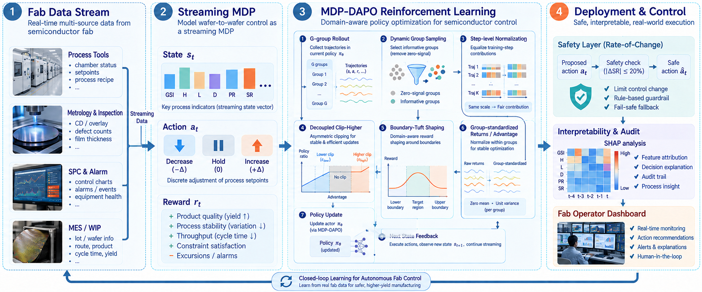

四个板块构成闭环：(1) **产线数据流**——工艺机台、计量/检测、SPC 报警、MES/WIP 归一化为流式状态；(2) **流式 MDP**——六维状态 s=(GSI, H, L, D, PR, SR)、三档动作 {down, hold, up}、V2.3 成本模型奖励；(3) **MDP-DAPO 训练核心**——Algorithm 1 挂载四组件优化模块（C1 解耦裁剪、C2 步级归一、C3 动态分组采样、C4 边界信任塑形）；(4) **部署与控制**——变化率安全层（|ΔSR|≤20%/步）、SHAP 可解释性审计、操作员看板。此图为 AI 起草的设计稿，caption 中明确列出投稿前的五项术语/符号对齐清单（见 8.1 的 B4），重绘前不矢量化，避免错误固化。

**主结果表 Table I** 即第〇章的总表。它的三个读法，每个都按数据实际支持的强度陈述：其一，默认更新体制下 PPO 是最弱的*非坍缩*学习基线（0.0825，连无梯度的 CEM 都不如——CEM 独立学出了恒定 50% 这个产线惯例工作点，与 Static 50% 在同一评测流上 reward 和均值 GSI 完全一致）；其二，主推配置 +20.1% vs PPO、+19.4% vs Static 50%（名义显著），数值上超过一切静态速率但对最优静态不显著；其三，reward 最优区风险耐受（GSI 2.52 vs Static 50% 的 0.86），但在与 Static 30% 几乎相同的负载下 GSI 低 17%。

**Fig. 2 评测轨迹图**——500 步留出流上的自然表现（无注入事件）：

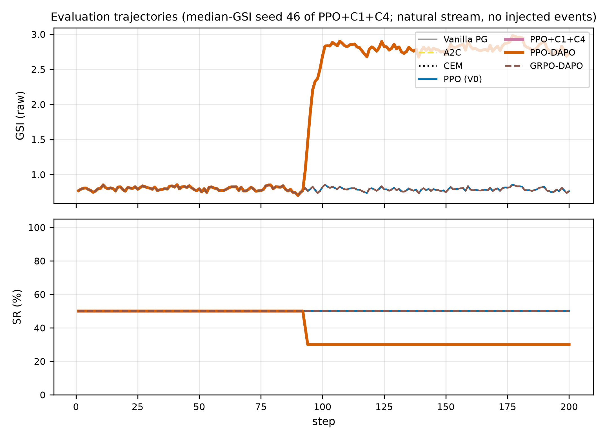

展示种子是中位 GSI 种子（46），选择标准事先声明而非挑出来的。上半为原始 GSI，下半为 SR（所有策略共享初始 SR=50%）。主推配置（紫色）与 PPO-DAPO（朱红，本种子上压盖紫色）在第 94 步左右降到学到的工作点 ≈30% 并保持——**在自然缺陷累积过程中 GSI 无抵抗地爬到 ≈2.8：160k 预算下策略学会了"在哪工作"，没学会"何时升档"**。同窗口内 A2C/CEM/PPO/GRPO-DAPO/Vanilla PG 全部重合在 50% 线上（caption 逐一枚举了重合线）。

**Fig. 3 SR 占用分布图**——8 个种子各自把抽检率用在了哪里：

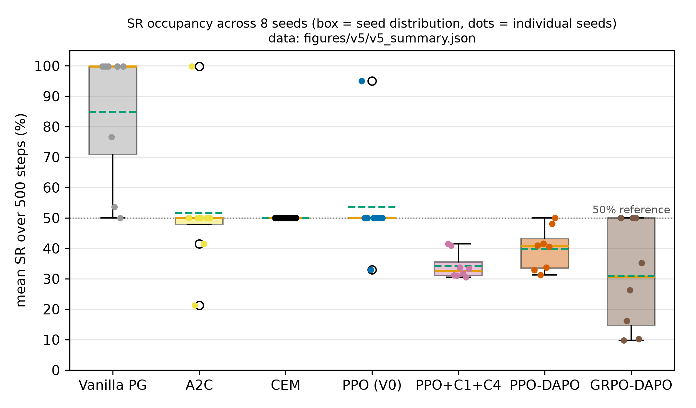

从数据重画的版本（10% 网格 + 50% 参考线），每个可见数值都能被 caption 复述：CEM 退化成一个点（8 种子全 50.0）；PPO 6 个种子钉在 50.0、两个离群（33.0/95.1）；Vanilla PG 五个种子饱和在 ≈99.8；A2C 散布 21.3/41.5/99.8；**主推配置全部落在内部区间（30.6–41.5，均值 34.2）**；GRPO-DAPO 散布 9.7–50.0——种子不稳定性一目了然。这张图同时是 Table I"non-collapsing"判定（8 种子均值 SR 全在 25%–75% 内）的可视化依据。

**Table II 消融表**——组件归因的核心证据：

| 变体 | C1 | C3 | C4a | C4b | Reward ↑ | GSI ↓ | L | SR(%) |
|---|---|---|---|---|---|---|---|---|
| PPO (V0) | – | – | – | – | 0.0825 | 0.968 | 0.611 | 53.5 |
| PPO+C1 | ✓ | – | – | – | 0.0825 | = PPO（界未收紧） | 0.611 | 53.5 |
| PPO+C4(a) only | – | – | ✓ | – | 0.0758 | **0.022** | 0.884 | 97.4 |
| PPO+C4(b) only | – | – | – | ✓ | 0.0964 | 2.493 | 0.386 | 34.7 |
| **PPO+C1+C4（主推）** | ✓ | – | ✓ | ✓ | **0.0991** | 2.518 | 0.388 | 34.2 |
| PPO-DAPO（full, +C3） | ✓ | ✓ | ✓ | ✓ | 0.0876 | 1.837 | 0.480 | 39.9 |

读法：C4a-only 把 GSI 打到全场最优的 0.022 却毁了 reward 经济（0.0758，SR 冲到 97.4%）——纯去偏只是加速冲边界；C4b 扛走全部 reward 相关增益（0.0964）；C3 当前净负（0.0876 < 0.0991），机制双重闭环（τ=0.01 逐位等同证明伤害来自过滤；默认 τ=0.05 下后期 ρ_eff=0.550 证明过滤确实在丢有效样本）；C1 默认体制下不激活。

**Table III 事件响应指标表 + Fig. 4 适应性图**——本论文最核心的新证据：

| 变体 | ΔSR (pp) ↑ | 延迟(步) ↓ | 恢复(步) | 事件窗 GSI ↓ | 事件窗 R* | ΔR vs Static 50% |
|---|---|---|---|---|---|---|
| PPO (V0), 160k | +0.3 ± 1.1 | — | — | 0.953 | −0.105 | +0.012 |
| PPO+C1+C4, 160k | −3.9 ± 3.4 | — | — | 3.327 | −0.184 | −0.067 |
| PPO+C1+C4, 300k | +49.8 ± 14.6 | 10.9 | 7.6 | 0.603 | −0.074 | +0.043 |
| PPO+C1+C4, 500k | **+60.8 ± 6.7** | **2.4** | 14.3 | **0.368** | **−0.046** | **+0.071** |
| PPO-DAPO (full), 160k | −0.9 ± 5.5 | — | — | 1.852 | −0.150 | −0.033 |
| Static 50% | 0.0 | — | — | 0.963 | −0.117 | 0.000 |

（*事件窗 reward 全为负是因为 excursion 窗口本身高代价（D 被强制驱动到 0.85），该列用于相对比较——500k 策略在事件内比 Static 50% 每步多挽回 +0.071，全表最大。）

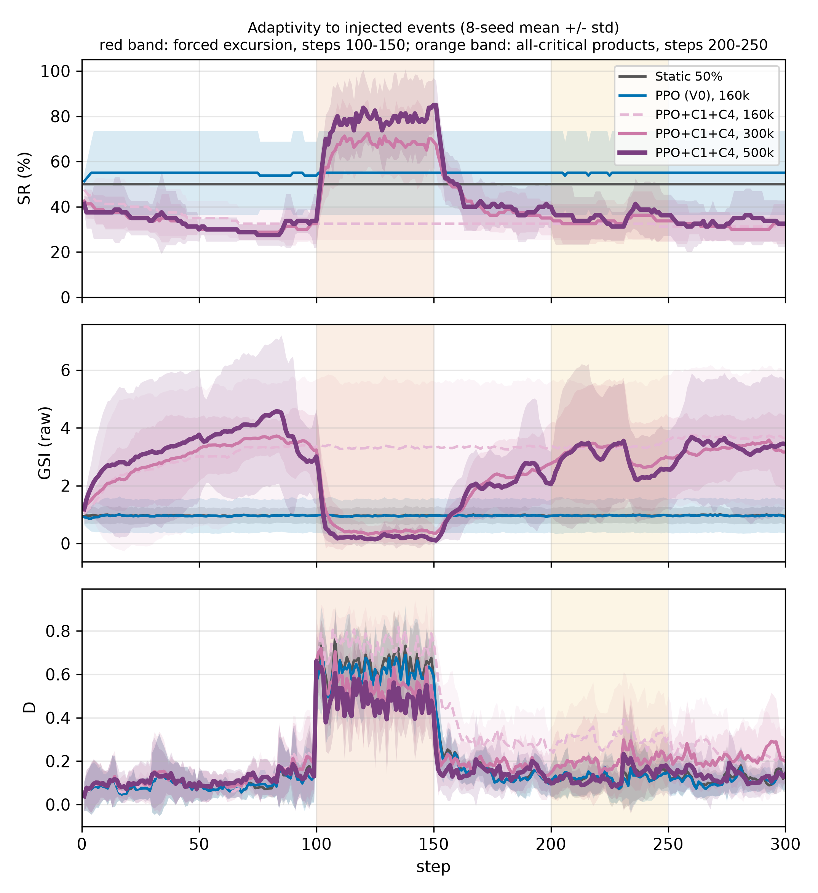

8 种子均值 ± std（非单 run）。红色带 = 强制持续性整厂 excursion（第 100–150 步，每台设备缺陷逐步驱动至 0.85 并置 persistence 标志，mean D 随"检出→维护"内生衰减）；橙色带 = 全关键产品窗口（第 200–250 步，PR=1.0）。三个共享横轴的子图分别是 SR、原始 GSI、平均缺陷率 D。Static 50%（灰）纹丝不动；PPO 160k（蓝）趴在饱和的 ≈55% 上无事件选择性；主推配置三档预算同一紫色家族——**160k（浅紫虚线）不响应**（GSI 爬到 ≈3.3）；**300k（中紫）起坡并保持**；**500k（深紫粗线）在 excursion 起点把 SR 从 ≈33% 拉到 ≈85%（延迟 2.4 步），整个事件期间把 GSI 钉在 ≈0.37**，事件后松弛回落，全关键产品窗口还有轻度再升档。

**Fig. 5 预算-响应曲线**——涌现的量化：

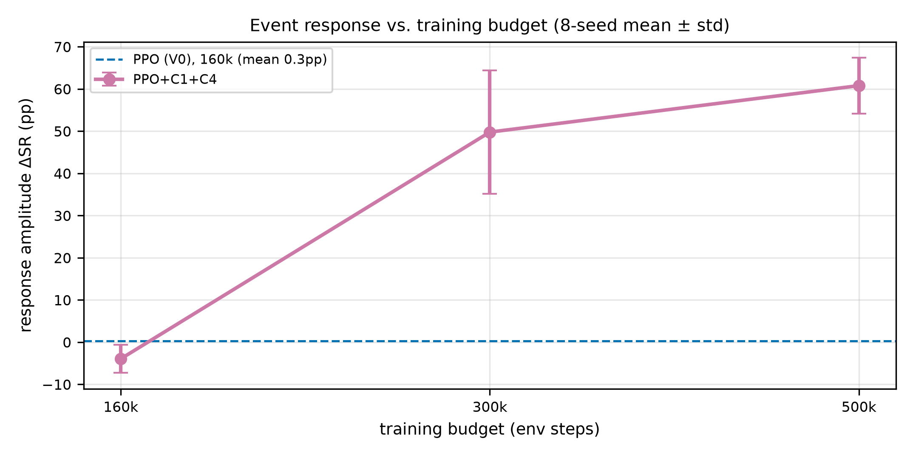

160k：−3.9 ± 3.4pp（无反射）；300k：+49.8 ± 14.6pp；500k：+60.8 ± 6.7pp 且延迟 2.4 步；PPO 160k 的 +0.3pp 作虚线参考。**事件反射是被优化预算门控的后发能力，不是组件即刻赋予的性质。** 配套的机理诊断（第六章 A1）：160k 策略 P(up|D>0.25)=0.000，500k 学到 0.343 vs 0.022；PPO 的 0.052 vs 0.114 则是升档与缺陷反相关的"边界饱和签名"。

**Fig. 6/7/8 训练动力学三联**——截断率、奖励、熵：

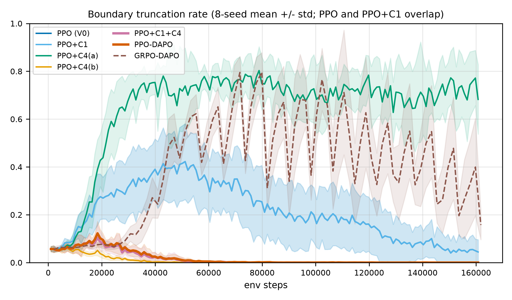

PPO+C4(a) 一路爬到 ≈0.7（策略住在边界上，绝大多数 up 请求被截断）；PPO 与 PPO+C1 中期升到 0.3–0.4（两线重合——C1 的非对称界在默认体制下从未收紧），随后随策略收敛**回落到 ≈0.2**（良性信息：策略成熟后离开边界）；所有含 C4b 的变体全程贴 0——**软边界带从源头消除了截断噪声，而不是事后掩蔽它**。

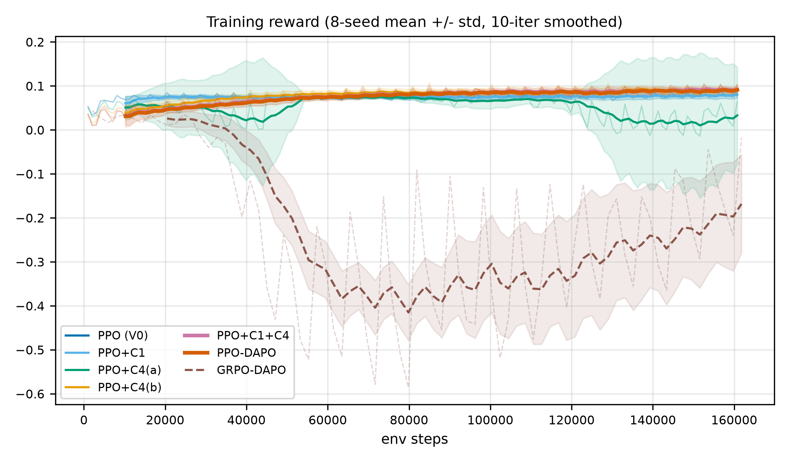

PPO 家族 40k 步内收敛到 0.05–0.10 区间；GRPO-DAPO（棕色虚线）全程剧烈震荡，4 个灾难种子在原始曲线的深谷里清晰可见；PPO+C4(a)（绿色）约 120k 步后向零衰减（个别种子转负）——边界驻留策略在难种子上持续累积逃逸成本暴露。

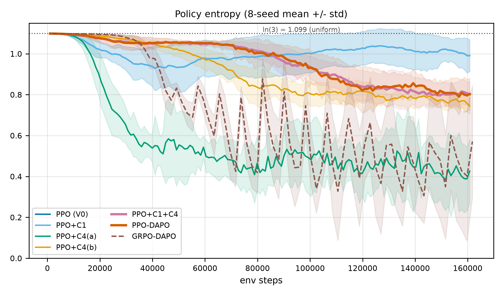

虚线参考 = 均匀策略最大值 ln3 ≈ 1.099。PPO 熵居高不下（≈1.0，近均匀，本质"不表态"）；DAPO 变体稳定在 0.75–0.9——对工作区域有适度信心、仍在动作间分配概率质量；PPO+C4(a) 坍缩最快（≈0.4）；GRPO-DAPO 锯齿反映不稳定种子。配合 Fig. 4 读：**0.75–0.9 的熵意味着策略对"在哪工作"有把握，但不蕴含"何时升档"的反射**。

**Fig. 9 风险-负载 Pareto 图**：

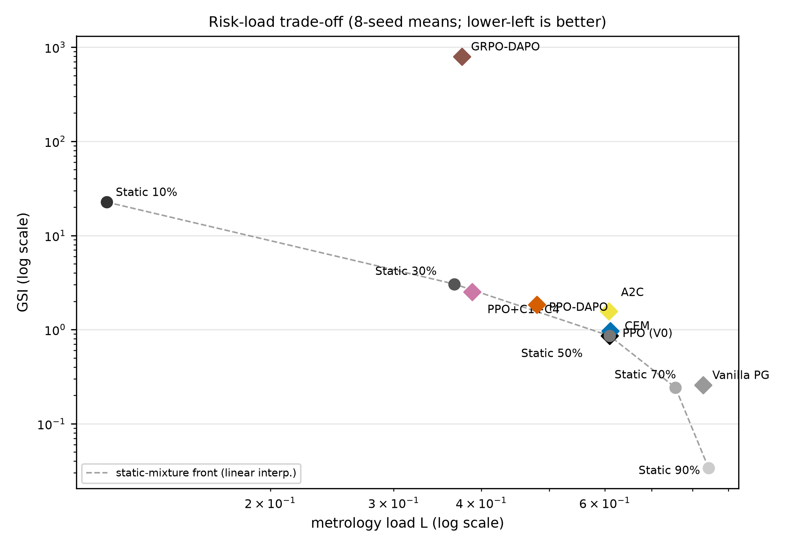

log-log 轴，左下更优。灰点为各静态速率及静态混合前沿（虚线），菱形为学习变体。主推配置（紫菱形）落在混合前沿上、紧邻 Static 30%——负载几乎相同（0.388 vs 0.366）但 GSI 低 17%，且比同负载的静态 30%/50% 线性插值低约 12%（前沿 ≈2.85 vs 2.52）。措辞纪律："在前沿上、略低于前沿"，而非"明确占优"。CEM 与 Static 50% 重合；GRPO-DAPO 灾难种子远在前沿上方。

**Fig. 10 默认 vs 激进更新体制**——claim 边界的可视化：

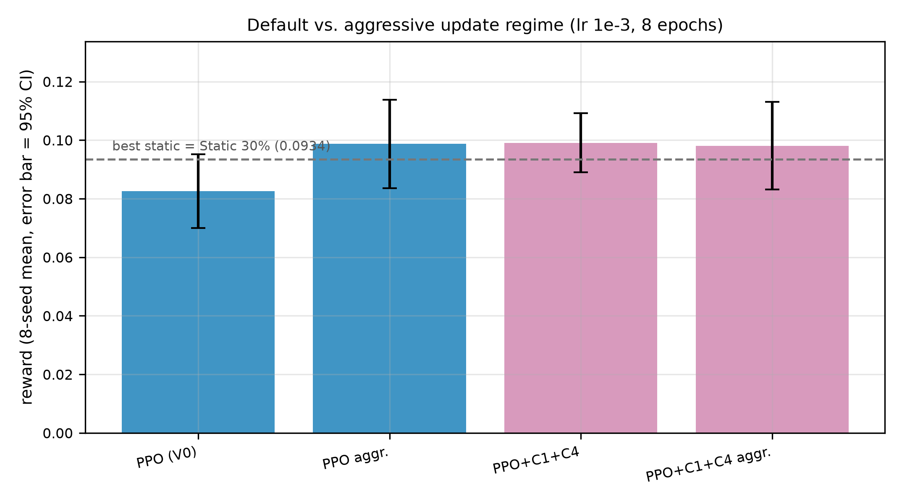

四根柱子（各 8 种子，95% CI，虚线 = 最优静态 0.0934）：默认体制下组件把 PPO 从"低于静态线"抬到榜首；激进体制下裸 PPO 追平（CI 更宽）且组件不再增益（p=1.00）。**DAPO 增益是默认/保守体制下的免调参结果**——愿意付调参成本和方差代价的人可以追平，但组件在那种体制下也不再帮忙。

**Fig. 11 SHAP 归因审计**：

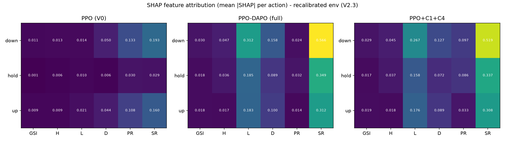

三联热图（左 PPO / 中 PPO-DAPO 全量 / 右主推配置；每动作 mean |SHAP|，共享色标；背景 = 随机策略下采样的 100 个状态）。DAPO 变体归因强度约为 PPO 的 3 倍（max |SHAP|：全量 0.566、主推 0.519 vs PPO 0.193），集中于 SR、L、D——策略 demonstrably 在读传感器；PPO 弱而散的归因是边界饱和的签名。三条坦白的 caveat 写进正文：(i) SR 的主导部分自指（SR 同时在状态和边界罚带中）；(ii) "升档←优先级"叙事在重标定后弱化（奖励连续定价逃逸暴露）；(iii) **归因强度 ≠ 事件反射**——SHAP 认证感知，Fig. 4 认证反应，只有 500k 策略两者兼备。

**Table IV 超参敏感性**（τ/δ/η 扫描）：扫描盒内无悬崖。四个诚实观察：默认 τ=0.05 是三个 τ 值中 reward 最差的——C3 的过滤（而非分组）伤害 benchmark 的又一证据；δ=0.05 与 η=0.2 在 3 种子下略优于默认但在噪声内；主矩阵坚持默认值、不做事后调参；η=0.2（0.1027, 3 seeds）不提拔进主表的原因写明——扫描是在 full 配置（含 C3）上做的，与主推配置不可比，且"把 3 种子扫描赢家提拔进主矩阵"恰恰是免调参 claim 所声明不做的事。τ/δ/η/c_pen 全部列入真实数据前强制重扫清单。

**附录 C 统计附录**：6 组配对 Wilcoxon 的 W 统计量与精确 p 全部可独立复算（W=2→0.0234、W=15→0.7422、W=14@n=7→1.0000、W=7→0.1484），Holm 校正序列 0.1406/0.1406/0.5938/1.0/1.0/1.0；"均值差更大反而 p 更大"的倒挂也作了解释（Wilcoxon 由符号与秩驱动，与均值差不单调）。

**附录 D GSI 约束变体**——risk-first 的标价单：

| 变体 | Reward ↑ | GSI ↓ | L | SR(%) |
|---|---|---|---|---|
| PPO+C1+C4（主推，无 GSI 惩罚） | **0.0991** | 2.518 | **0.388** | 34.2 |
| PPO+C1+C4 + GSI 惩罚 | 0.0889 | **0.610** | 0.651 | 56.6 |
| PPO (V0) | 0.0825 | 0.968 | 0.611 | 53.5 |
| Static 50% | 0.0830 | 0.860 | 0.609 | 50.0 |

λ_G=0.5 把平均 GSI 从 2.52 压到 0.61（优于 Static 50%），代价 reward −10%（仍高于 PPO 和 Static 50%）、负载升至 0.651。reward-first / risk-first 之间由单标量 λ_G 连续可调。

**Fig. A1 有效梯度占比 ρ_eff**（C3 的机制证据，附录图）：

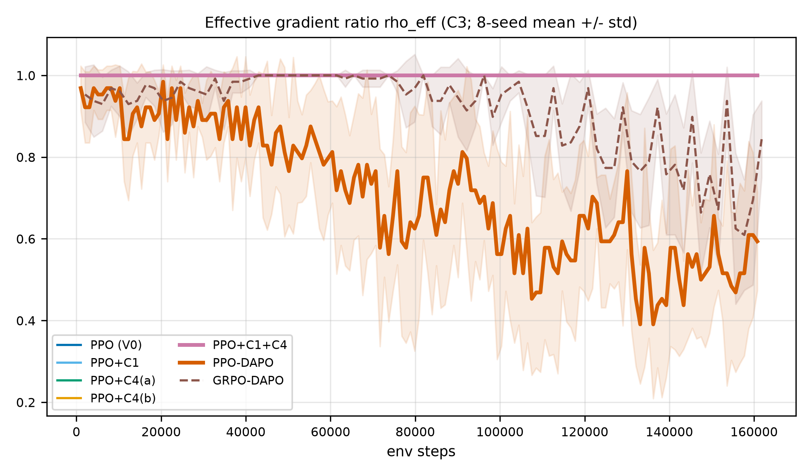

只有含 C3 的变体（PPO-DAPO、GRPO-DAPO）跌破 1.0；full 配置后期 ρ_eff 均值 0.550（8 种子，逐种子范围 [0.48, 0.59]）——**C3 在训练后期丢弃约 45% 的样本，而在这个平稳工况为主的 regime 里那些样本仍携带信号**。这就是"C3 当前净负"的机制定论；C3 保留在框架内，等待真实产线长稳态工况（V1 环境实测 ρ_eff 曾跌至 0.125）的检验。

## 九、仿真环境与数据集详解

所有结论都建立在 V2.3 合成仿真器之上。这一章把"舞台"完整拆开：仿真器的机制与参数、状态特征、数据规模，以及本项目的全部数据资产和真实数据接入规范。

### 9.1 为什么需要合成仿真器

真实产线数据（FDC/MES/DMS）尚未到位，而用户侧工程约束明确：Windows 可跑、CPU/GPU 双版本、先行打理论地基。因此全部实验在合成流式仿真器上完成，论文全程声明：**合成环境结果仅展示方法可行性，真实数据接入后需全部重跑**。仿真器设计的第一原则是 V1 危机换来的教训——必须抗静态解（见第二章的五大机制）。

### 9.2 仿真器 V2.3 完整规格

- **设备**：R = 8 台；检测抑制上限 IL_i ~ U(50, 150) 片；额定产能 base_output_i ~ U(10, 30) 片/步；种子内固定。
- **生产**：produced_i = base_output_i · U(0.8, 1.2)。
- **W@R（在制未检晶圆）更新**：W@R ← (W@R + produced)·(1 − SR)。
- **缺陷漂移**：d_i += N(0, 0.01 + 0.04(1 − h_i))（健康度越差漂移越快）；单设备突发 p = 0.015/步，幅度 U(0.4, 0.9)。
- **整厂 excursion**：未激活时 p = 0.005/步触发（全部 d_i += U(0.4, 0.7)）；激活期间每步 d_i += 0.05；当 mean(d) < 0.2 时结束。
- **检测与维护**：设备 i 以概率 SR × 0.6 被检出（**不完美检测**）；若检出且 d_i > 0.35 → d_i = 0、h_i += 0.5（检出触发维护）。
- **老化**：h_i −= 0.002 + 0.01·d_i·(1 − SR)；h ∈ [0.1, 1]。
- **产品组合**：PR ∈ {1, 0.5, 0}，每步 5% 概率切换。
- **计量拥塞**：c_t ∈ {0.5, 1.0}，每步 2% 概率翻转；L = Σ(produced·SR) / (Σbase_output · 1.2 · c_t) · (0.8 + 0.4·PR)，截断到 [0, 1]。
- **GSI**：Σ_i (W@R_i / IL_i)^1.5；归一化尺度 = R · 2^1.5。
- **注入事件协议（适应性评测专用）**：excursion 窗口（第 100–150 步）内每台设备缺陷**每步**被驱动至 0.85 并置 persistence 标志，动力学照常生效（被检出的设备被清除，故窗口内 mean D 震荡衰减）；全关键产品窗口（第 200–250 步）内 PR = 1.0。

### 9.3 状态特征与动作空间

策略每步看到的六维状态向量：

| 特征 | 含义 | 取值范围 | 物理意义 |
|---|---|---|---|
| GSI | 全局稳定性指数（归一化） | [0,1]（原始值无上界） | 全场"在制未检"风险的非线性聚合，越大越危险 |
| H | 平均设备健康度 | [0,1] | 1 = 全新，0.1 = 失效边缘 |
| L | 计量负载 | [0,1] | 抽检占用的计量产能比例，拥塞时同样 SR 更"贵" |
| D | 平均缺陷率 | [0,1] | 当前缺陷水平 |
| PR | 产品优先级 | **恰好** {1.0, 0.5, 0.0} | 关键 / 普通 / 非关键产品 |
| SR | 当前抽检率 | {0, 0.1, …, 1.0} 共 11 档 | 上一步动作的结果，硬边界钳制 |

动作空间 A = {down, hold, up}：SR 减一档 / 不变 / 加一档（每档 10pp）。**硬边界截断**：SR=0 时 down、SR=100% 时 up 被强制改为 hold，并置截断标志 m_k——这正是 C4a 组件处理的噪声源（原理见第十章）。

### 9.4 实验数据规模

| 维度 | 规模 |
|---|---|
| 单 run 训练量 | 160k 环境步（适应性研究扩展 300k / 500k） |
| 单迭代批量 | G×T = 8×128 = 1024 步（critic-free G=16） |
| 主矩阵 | 6 个学习变体 × 8 种子（42–49）+ 5 档静态基线 |
| 评测协议 | 500 步留出流 × 8 条（流种子 = 训练种子 + 10000，全体变体共享同 8 条流） |
| 适应性研究 | 3 预算 × 8 种子 = 24 个新 run（run 标签 v6mid/v6long） |
| 消融与变体 | 组件消融 6 配置 × 8 种子；激进体制 2 配置 × 8 种子；GSI 变体 8 种子；敏感性扫描若干 |
| 算力 | 全部在 CPU（Ryzen 5 5600）完成，单条 160k 主实验约 1–2 分钟 |

### 9.5 数据资产清单（不只是表格，逐个讲）

**① 逐步仿真记录 `sample_simulated_data.csv`**（`mdp_dapo/`，30 步样例）：每行一个决策步，15 列——`step, action, GSI_obs, H, L, D, PR, SR, reward, r_base, r_pen, truncated, GSI_raw, W@R_mean`。从样例可以直接读到仿真器的性格：第 7–10 步 SR 顶到 1.0 后 `truncated=True` 反复出现（up 被硬截断为 hold）；SR 高位时 W@R_mean 被压到 0、GSI_raw 归零；第 11 步降档后 W@R 重新累积。**这张小表就是 C4a 截断噪声问题的最小可复现样本。**

**② 训练评测宽表 `data_training.xlsx`**（500 行 × 6 算法块）：V0 论文版式——每个算法占 9 列（Algorithm/Step/SR/W@R/D/H/L/P/GSI，SR 为百分数，GSI 为原始未归一化值），算法块之间空 2 列；500 步评测轨迹逐行记录。`data_training_ppo.xlsx` 是同版式的 PPO 单算法版（多一列 Action）。`evaluate.py` 的输出与这个版式逐列对齐——**真实数据一到即可套用同一管线**。

**③ 主结果表 `results_v5.xlsx`**（`mdp_dapo/`）：封版口径的唯一权威数据源，含全部变体的 per-seed 列；Table I/II 的每个数字都能在这里点到名。配套 `figures/v5/v5_summary.json`（占用图数据源）与 `figures/v5/v6_adaptivity_{traces,metrics,summary}.csv`（适应性研究三级数据：逐条轨迹 / 逐 run 指标 / 跨种子汇总）。

**④ 训练 run 存档 `mdp_dapo/runs/`**：每个 run 一个目录（`config.json` 完整超参 + `metrics.csv` 逐迭代指标 + `checkpoint.pt` 模型），标签体系：v4* = 主矩阵、v4agg/v5aggc1c4 = 激进体制、v6mid = 300k、v6long = 500k、v6gsipen = GSI 变体。所有图的 caption 都携带这些 run 索引。

**⑤ 真实数据接入规范 `real_data_spec.md`**（V1.0，与 `RealDataFabEnv` 骨架对齐）：约定三表结构——

- **`fact_step.csv`（步级事实表，每决策步一行，11 列）**：`step_id`（连续不断号）、`timestamp`（等间隔）、`sr_executed`（**实际执行**的抽检率，离线 RL 的红线字段，缺失即无法训练）、`wafers_produced_total`、`wafers_inspected_total`、`pr`（恰 ∈ {1.0, 0.5, 0.0}）、`defect_rate_inline`（比例非个数）、`defect_count_offline_72h` / `_3m`（归一化窗口，严禁用未来数据）、`metrology_capacity`（可用产能非装机产能）、`maintenance_flag`。
- **`fact_tool_step.csv`（设备×步明细表，6 列）**：核心是 `last_valid_inspection_step`——W@R 定义的直接输入，**此列错误会直接导致 GSI 全部错误**，规范中标注为最关键字段。
- **`dim_tool.csv`（设备静态参数表，4 列）**：`IL`（检测抑制上限，GSI 公式分母，需工艺工程师签字确认）、`process_stage`（为多工位扩展预留）、`base_output`。

规范还定义了缺失/异常处理规则（"未被检 ≠ 检了没缺陷"，NaN 不许填 0）、降级方案（缺 `health_index` 可用"距上次维护步数"启发式替代；缺 `sr_executed` 是红线）与自动校验脚本（`tools/validate_real_data.py`）。数据规模约定：500 步 ≈ 2 个月产线数据，交付不少于 3 个月连续数据（160k 训练步 + 500 步独立测试段）。

## 十、数学公式原理详解（教学向）

这一章把论文的方法数学逐条拆开讲，目标是让没读过 PPO/DAPO 原文的读者也能看懂每个符号为什么存在。

### 10.1 地基：流式 MDP 与风险的几何

强化学习把问题建模为 MDP：$\mathcal{M} = \langle \mathcal{S}, \mathcal{A}, \mathcal{P}, r, \gamma \rangle$——状态、动作、转移、奖励、折扣因子（γ=0.96）。我们的状态是 9.3 节的六元组，动作是三档调率。这里真正的领域知识在两个量上：

**W@R（Wafers at Risk，在制未检晶圆数）**：设备 i 自上次有效检测以来累计产出的晶圆数，

$$\mathrm{W@R}_{k}^{(i)} = \sum_{t=t_{\text{last}}^{(i)}}^{t_{\text{now}}} N_{i,t}$$

直觉：一批晶圆如果没被抽检，它们的缺陷状态就是"未知的在险资产"，累积得越多，一旦设备出问题，报废面越大。

**GSI（Global Stability Index）**：把各设备的 W@R 相对其检测抑制上限 IL 归一后做**非线性放大**再求和，

$$\mathrm{GSI}_k = \sum_{i=1}^{R} \left( \frac{\mathrm{W@R}_{k}^{(i)}}{\mathrm{IL}_i} \right)^{\vartheta},\quad \vartheta = 1.5$$

为什么 ϑ=1.5 而不是 1？因为风险的分布形状比总量更重要：一台设备 W@R/IL=0.8（逼近上限）比四台各 0.2 危险得多，凸指数（>1）让"逼近上限的单点"在指标中占优。GSI 是产线工程师的风险语言——这也是论文坚持把 GSI 作为辅助诊断指标与 reward 并列报告的原因。

### 10.2 奖励函数：把五个互相打架的目标折成一个数

$$r_k^{\text{base}} = \underbrace{\omega_1 H_k}_{\text{健康}} - \underbrace{\omega_2\,|\Delta \mathrm{GSI}_k|}_{\text{波动}} - \underbrace{\omega_3 L_k}_{\text{负载}} - \underbrace{\omega_4 D_k}_{\text{缺陷}} \;-\; \underbrace{\omega_5\, \mathrm{PR}_k D_k (1 - \mathrm{SR}_k)}_{\text{关键产品漏检}} \;-\; \underbrace{\kappa\, D_k (1 - \mathrm{SR}_k)}_{\text{缺陷逃逸}}$$

逐项读法（权重 ω=(0.25, 0.35, 0.15, 0.25)，ω5=0.2，κ=0.3）：

- **+ω₁H**：奖励设备健康——唯一为正的主项，给策略一个"保住设备"的长期动机；
- **−ω₂|ΔGSI|**：惩罚 GSI 的**波动**（对称、不管水平高低）——这是 V0 的设计，目标是"稳"；
- **−ω₃L**：惩罚计量负载——抽检的成本项；
- **−ω₄D**：惩罚缺陷水平本身；
- **−ω₅·PR·D·(1−SR)**：关键产品期的漏检风险——PR=1 时漏检最贵；
- **−κ·D·(1−SR)**：V2.3 重标定加的核心项——**漏检直接定价为良率损失**。

注意一个深刻的设计事实：GSI 只经 |ΔGSI|（波动项）**弱耦合**进奖励，而逃逸成本被 −κD(1−SR) **直接定价**。这带来两个后果：其一，奖励最优的策略可以容忍比"风险优先"操作员更高的平均 GSI（主表里主推配置 GSI 2.52 vs Static 50% 的 0.86 就是这么来的）；其二，PPO 早期"钻 load 项空子"（少检换低负载）部分是奖励设计的必然产物，不纯是优化失败。这两点在论文 VI 节都显式讨论了。

另有一个 V0 遗留的**物理单调性惩罚** $r^{\text{pen}} = -c_{\text{pen}} \mathbb{1}[a_k = \text{up} \wedge m_k = 1 \wedge \mathrm{GSI}_k \geq \mathrm{GSI}_{k-1}]$（c_pen=0.5）："在 SR=100% 还要求升档（被截断）且 GSI 没降"时罚一笔——防止策略无脑顶格。

### 10.3 PPO 基座：三个零件

**重要性比率**：$\rho_k(\theta) = \pi_\theta(a_k|s_k) / \pi_{\theta_{\text{old}}}(a_k|s_k)$——新策略相对旧策略对同一动作的偏好倍数。ρ=1.1 就是"新策略比以前更愿意 10% 做这个动作"。

**GAE 优势估计**：$\delta_k = r_k + \gamma \hat{V}(s_{k+1}) - \hat{V}(s_k)$（TD 残差，"这一步比预期好多少"），$\hat{A}_k^{\text{GAE}} = \sum_l (\gamma\lambda)^l \delta_{k+l}$（λ=0.95 的指数加权把多步残差合成低方差优势）。**critic（价值网络 $\hat{V}_\phi$）就在这里承重**——没有它，"预期"无从谈起，这就是 GRPO-DAPO 去掉 critic 后 4/8 种子坍缩的结构性原因。

**对称裁剪替代目标**：$\mathcal{J}^{\text{CLIP}} = \mathbb{E}[\min(\rho_k \hat{A}_k,\ \mathrm{clip}(\rho_k, 1-\varepsilon, 1+\varepsilon)\hat{A}_k)]$，ε=0.2。min 结构保证：无论优势正负，目标函数都不奖励 ρ 超出 [0.8, 1.2] 的部分——每轮更新被限制在旧策略附近的"信任域"内。总损失再加价值损失和熵正则：$\mathcal{L} = -\mathcal{J}^{\text{CLIP}} + 0.5\,\mathcal{L}^{\text{VF}} - 0.01\,H(\pi_\theta)$。

### 10.4 C1 解耦裁剪：为什么上界要比下界松

$$\mathcal{J}^{\text{C1}}(\theta) = \mathbb{E}_k \Big[ \min\big( \rho_k \hat{A}_k,\ \mathrm{clip}(\rho_k, 1-\varepsilon_{\text{low}}, 1+\varepsilon_{\text{high}})\, \hat{A}_k \big) \Big],\quad \varepsilon_{\text{low}} = 0.2,\ \varepsilon_{\text{high}} = 0.28$$

机制讲解：对称裁剪下，一个低概率动作每轮迭代最多涨 1+ε 倍。考虑 excursion 期间的"升档纠偏"动作——它在平稳期是稀有动作（概率可能只有 0.05），一旦被某轮更新压下去，需要很多轮 +20% 的连涨才能爬回来，实际上**学不回来**（LLM 场景里这就是熵坍缩：稀有 token 被压死后策略多样性丧失）。把上界放宽到 +28%（下界不动），等于单独给"低概率的纠偏动作"重开了一条恢复通道。本项目的实证补充了一层 nuance：**默认更新体制下这个界从未收紧**（C1 不激活，PPO+C1 ≡ PPO 逐位相同），只有在激进体制（lr 1e-3）下它才激活并保住熵（0.62 vs 0.38）——C1 是体制依赖的保险丝，不是常驻增益。

### 10.5 C2 步级损失归一：分母的学问

$$\mathcal{L}_{\text{sample-level}} = \frac{1}{G}\sum_g \frac{1}{T_g}\sum_t \ell_{g,t} \;\Longrightarrow\; \mathcal{L}_{\text{step-level}} = \frac{1}{\sum_g T_g}\sum_g \sum_t \ell_{g,t}$$

左边先组内平均再组间平均：每条轨迹无论长短话语权相同——长轨迹里单个关键决策的信号被摊薄（LLM 里"长回复被稀释"的同构）。右边全体决策步等权：每一步一票。论文如实写了边界：**单产线场景下所有组等长（T=128），两种平均在数学上退化为一回事**；C2 要到多工位扩展（各工位轨迹长度不一）才实质化。这是"移植不是照抄，每条都要重新定价"的典型一例。

### 10.6 C3 动态分组采样：给经验也配一个"策略"

每轮迭代从当前状态分叉 G=8 路并行 rollout（深拷贝环境全状态 + 独立随机流，见第一章）。对每组计算步内奖励标准差 σ_g：**σ_g < τ=0.05 的组判为"零信号组"**——组内回报几乎无差异，中心化优势恒为零，梯度 ≈0，这种组只会稀释 batch。处置：从策略损失中屏蔽并过采样替补；同时记录有效梯度占比 ρ_eff（保留下来的步数占比）。

直觉一句话：**策略选择检哪些晶圆，训练器选择学哪些经验——双层采样**。与优先经验回放（PER）的区别：PER 是离线机制（给回放缓冲区的历史样本打优先级，引入陈旧样本偏移）；C3 是在线机制（同批 rollout 的组内相对信号），不维护缓冲。

本项目的实证结论（诚实报告）：**合成 benchmark 上 C3 是净负贡献**。机制双证据：τ 放到 0.01 时过滤从未触发、与 w/o-C3 逐位相同（伤害不来自分组本身）；默认 τ=0.05 时后期 ρ_eff=0.55——平稳工况里被判为"零信号"的样本其实仍携带信号，丢它们是净损失。C3 的用武之地是真实产线的长稳态campaign（V1 环境实测 ρ_eff 曾跌到 0.125，那种工况下过滤才对），留待真实数据阶段检验。

### 10.7 C4 边界信任奖励塑形：一半修估计，一半修目标

**C4a 截断噪声掩蔽（修估计器）**。SR=100% 时 up 被硬截断为 hold：实际执行的是 hold，观测奖励 r(s, hold) 却被记到 up 头上，梯度估计 $\hat{g}_k = \nabla_\theta \log \pi_\theta(a_k|s_k) \hat{A}_k$ 系统性失真——这是纯粹的估计偏差。修法：截断转移（m_k=1）从策略损失中屏蔽（m_k 乘进替代目标），但保留在价值损失里（价值网络仍应知道世界真实发生了什么）。

**C4b 软边界惩罚带（修目标）**。把 SR ∈ {0, 100%} 处不连续的硬钳制换成可定价的坡：

$$r_k^{\text{boundary}} = -\eta \cdot \max\big(0,\ |\mathrm{SR}_k - 0.5| - (0.5 - \delta)\big) / \delta,\quad \delta = 0.1,\ \eta = 0.1$$

读法：SR 在 [40%, 60%] 内惩罚为 0（平底）；越出后线性递增，到边界处达到 −η=−0.1。形状是一个**平底 V 形**——给策略一个"免费的内部工作区"，同时让驻留边界有连续可感的价格。关键的纪律：这个惩罚带**只在训练期生效**，评测时用未塑形奖励——否则 C4b 的增益是自我循环（"奖励策略待在只有塑形项才造出来的带内"）。消融证明了两半的关系：C4a 单独使用 = 去掉估计偏差后策略加速冲向边界（SR≈97%，reward 崩塌）；C4b 扛走全部 reward 增益。**估计修正必须配目标修正。**

### 10.8 统一目标函数： boxed 公式逐符号读

$$\boxed{\ \mathcal{J}^{\text{MDP-DAPO}}(\theta) = \frac{1}{\sum_{g \in \text{keep}} T_g} \sum_{g \in \text{keep}} \sum_{t=1}^{T_g} m_{g,t} \min\Big( \rho_{g,t} \hat{A}_{g,t},\ \mathrm{clip}\big(\rho_{g,t}, 1-\varepsilon_{\text{low}}, 1+\varepsilon_{\text{high}}\big) \hat{A}_{g,t} \Big)\ }$$

从里到外：$\rho\hat{A}$ 与裁剪项取 min（PPO 信任域）；裁剪界非对称（C1）；$m_{g,t}$ 乘在前面（C4a 截断掩蔽）；求和只跑 g ∈ keep 的组（C3 过滤）；分母是保留组的**总步数**而非组数（C2 步级归一）；优势 $\hat{A}$ 在混合版来自 GAE（critic 承重），critic-free 版来自组内标准化 $\hat{A}_{g,t} = (R_g - \mathrm{mean}_{g'} R_{g'}) / (\mathrm{std}_{g'} R_{g'} + \epsilon)$。一个公式，四个组件的挂载点全部可见——这也是论文 Algorithm 1 的数学对应物。

### 10.9 统计方法：显著性声明是怎么做出来的

**配对 Wilcoxon 符号秩检验**：8 个训练种子 × 8 条共享评测流的配对结构下，对每个对比（如主推 vs PPO）计算 8 个逐种子差值，按 |差值| 排秩、按符号分堆，W 统计量取较小一侧的秩和。它不假设正态——n=8 的小样本下这是稳妥选择。注意它的性质：**由符号与秩驱动，与均值差不单调**——所以会出现"均值差更大反而 p 更大"的倒挂（激进 PPO vs S30：均值差 +0.0053、p=0.15；主推 vs S30：+0.0057、p=0.74），附录 C 对此作了专门解释。

**Holm 多重比较校正**：本研究预先声明了 6 组对比，若每组都按 p<0.05 单独判，家族错误率会膨胀。Holm 法把 6 个 p 值从小到大排序，第 i 个与 0.05/(6−i+1) 比较，逐级把关。结果：vs PPO 与 vs Static 50% 的 0.0234 校正后变为 0.1406——**不再显著**。我们把正文全部降级为"nominal significant (uncorrected)"，并把 6 组完整的配对差值序列、W 统计量、校正序列（0.1406/0.1406/0.5938/1.0/1.0/1.0）放进附录 C 供独立复算。n=8 的功效天花板摆在那里，最终裁决留给真实数据阶段的更大 n。

## 十一、总结：五轮评审买到了什么

回看 V1 → V6.2，这个项目最有价值的产出不是某个数字，而是被反复验证的工作原则：

1. **Benchmark 先于方法**（V1 的静态 50% 危机：平凡环境里一切方法对比都无信息量）；
2. **基线、图件与算法同等级别地被怀疑**（float32 死区极限环；适应性图双重错位；占用图降采样误读）；
3. **每一句 claim 钉到它实际拥有的最强证据上**——评审不是敌人，是把论文从"看起来对"变成"查得出来对"的机制；
4. **跨实验代际的数字不得混排**——每个单元格都要有单一、可点名、带版本的数据来源。

最终的证据清单（合成阶段封版口径）：重标定 benchmark 抗静态解（oracle 证据）；默认体制下 PPO 是最弱的非坍缩学习基线；PPO+C1+C4 以名义显著性胜过 PPO 与 Static 50%，数值上超过一切静态速率；增益分解为 目标修正（C4b）> 估计修正（C4a 单独使用退化）；critic 是承重墙；C1 体制依赖、C3 合成证据不支持（机制 = 过度过滤）；激进调参可追平——claim 关于保守体制而非 PPO 上限；事件反射真实存在但被预算门控。

## 十二、下一阶段计划：主推配置的仿真测试集大考

论文已经回答了"哪个配置好"（PPO+C1+C4，MDP-DAPO w/o C3），下一阶段要回答所有人最关心的问题：**这个配置在仿真测试集上的表现到底怎么样、有多稳、边界在哪。** 在接入真实数据之前，我们计划对主推配置做一次系统性的"封版后大考"：

1. **大规模留出评测**：主推配置（以及 PPO、Static 30%/50% 对照）在更大规模的仿真测试流上评测——更多种子（n>8，直接回应 Holm 校正后不显著的问题）、更长的评测流（500 步 → 数千步，覆盖多个 excursion 周期），给出带置信区间的最终测试集成绩单；
2. **三档预算的部署形态对照**：160k / 300k / 500k 三个 checkpoint 在同一测试集上的并排评测，把"预算门控的反射涌现"从训练现象变成可报价的部署选项（160k = GSI 优势但无反射；500k = 反射延迟 2.4 步但 3 倍训练成本）；
3. **压力与鲁棒性测试**：excursion 强度/时长扫描、拥塞率扰动、奖励权重扰动下的性能衰减曲线——定位主推配置的安全包线；
4. **风险形态对照**：主推配置 vs GSI 惩罚变体（λ_G=0.5）在同一测试集上的 reward-GSI-负载三轴对照，把"risk-first 的标价"从单次观测变成可复算的曲线；
5. **真实数据接入准备**：按 `real_data_spec.md` 完成数据校验管线；`RealDataFabEnv` 骨架已实现（保持 reset/step 接口不变，上层算法零改动切换）；真实数据一到，全部结论在真实奖励尺度下重跑，τ/δ/η/c_pen/λ_G 进入强制重扫清单。

投稿级杂项同步推进：Fig. 1 架构图按评审五项清单对齐后矢量重绘、矢量 PDF 导出、字体统一、IEEE ICSE 撞名核查。

项目启动时我们说：路虽难，保持创新大胆和谨慎。现在可以补上下半句——**大胆负责提出同构假设，谨慎负责把它一寸寸钉死。** 合成阶段已经钉完，真实数据阶段见。

---

### 附：资产索引

| 资产 | 位置 |
|---|---|
| 论文手稿 V1–V6.2 | `Manuscript_DAPO_V{1,2}_draft.md`、`V{3,4,5,6}_demo.md`、`V6.{1,2}_demo.md` |
| 五轮评审意见 | `advice{,2,3,4,5}.md` |
| 设计文档 | `DAPO_adaptation_design.md` |
| 真实数据规范 | `real_data_spec.md` |
| 代码库 | `mdp_dapo/`（train/evaluate/envs/dapo/tools） |
| 主结果表 | `mdp_dapo/results_v5.xlsx` |
| 适应性数据 | `mdp_dapo/figures/v5/v6_adaptivity_{traces,metrics,summary}.csv` |
| 全部图件 | `manuscript_figures/` |
| 验证脚本 | `mdp_dapo/tools/replot_v61.py`、`verify_v62.py` |
| 研究日志 | `research_log.md`（本博客的档案底稿） |

