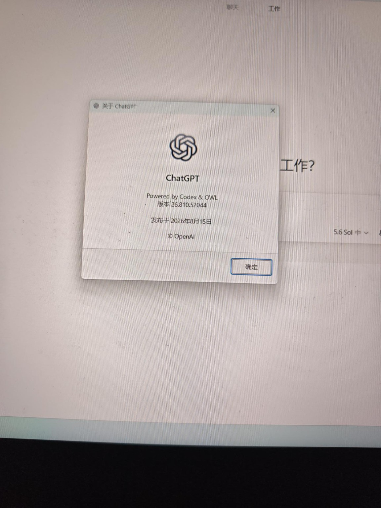
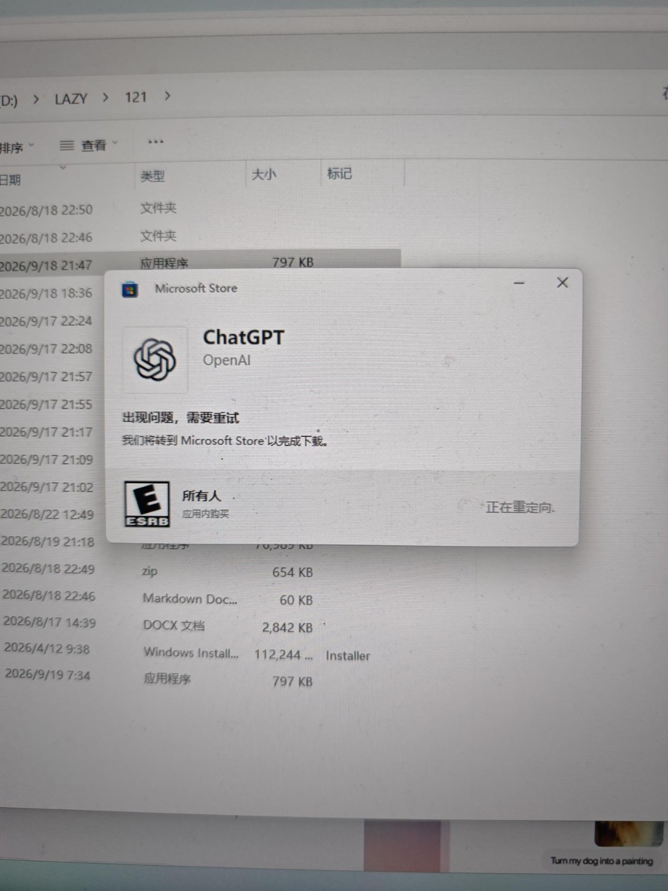
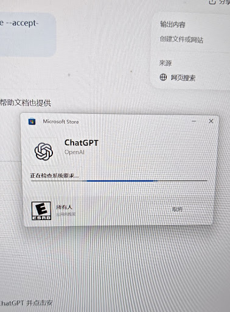
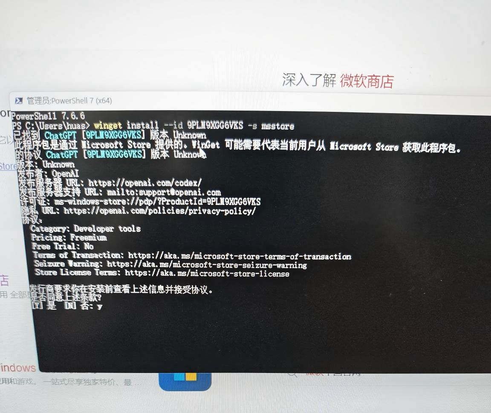
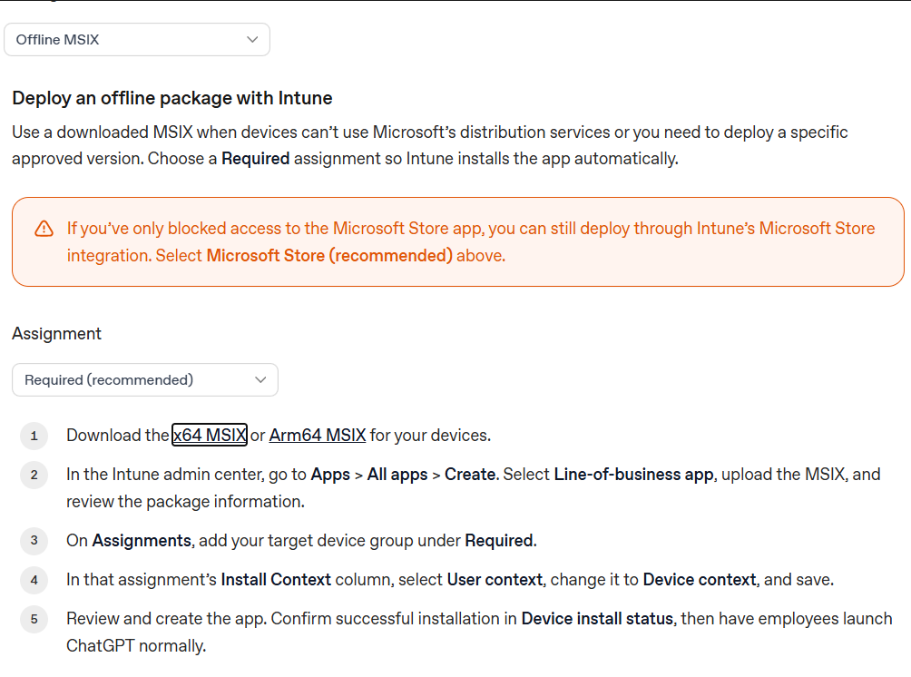

# ChatGPT Windows 11 桌面版安装故障排查 SOP

> **案例日期：** 2026-09-19
> **操作系统：** Windows 11
> **系统架构：** x64
> **目标应用：** OpenAI ChatGPT Windows Desktop
> **最终状态：** ✅ 安装成功并正常启动
> **最终有效方案：** 官方 x64 MSIX + PowerShell `Add-AppxPackage`

## 1. 故障背景

原本 ChatGPT Windows 桌面版可以正常使用。且截至9月18日，GPT-6 Astra 已经开放，但不同套餐/模式的开放范围不同：

Pro $100 / $200、Business、Enterprise：GPT-6 Pro（Astra）已经可用于 ChatGPT；Enterprise 还可能受管理员权限控制。
Plus：GPT-6 Astra 目前可用于 ChatGPT Work 和 Codex，但不是普通 Chat 里的 GPT-6 Pro。
OpenAI 还特别写明：桌面端看不到 Astra 时，需要更新到最新版桌面 App。

所以如果网页端已经能看到 GPT-6/Astra，而桌面端仍然只有 5.6，那就很像是桌面客户端版本的问题。官方甚至建议：更新一次并完全退出重开之后，再检查一次更新，因为有时还会继续出现第二个更新。最省事的处理方式是：先完全退出桌面 ChatGPT → 重新打开 → 再点一次 Menu → Check for Updates。Windows 桌面版是 26.810.52044，发布日期 2026 年 8 月 15 日。OpenAI 最新官方说明明确说：如果桌面端看不到 Astra / GPT-6，需要手动更新到最新 Desktop App；而且有时一次更新还不够——安装后彻底退出重开，再执行一次“检查更新”。



一般情况下先不要卸载你现在的 ChatGPT，避免最后新版没装上，旧版也没了。(但是我还是卸载了)

直接打开 Windows 的 Microsoft Store。然后在 Store 顶部搜索：ChatGPT。确认发布者是 OpenAI，进入以后看看按钮显示什么：
如果是 “更新” → 直接点更新。
如果是 “打开” → 去 Microsoft Store 的 “库 / Library” → “获取更新 / Check for updates”，看看 ChatGPT 有没有更新。
如果 Microsoft Store 本身也一直转圈、报错或者打不开 → 那问题基本就是 Store/Windows 的下载服务异常，我们就处理 Store，而不是继续折腾 ChatGPT。

这张截图里的 “正在重定向……”且超过十分钟还没变化，直接关掉就行，继续等通常没什么意义。

还有一点很关键：先别卸载旧版。 等我们把 Microsoft Store 恢复正常、新版 ChatGPT 确实装好，再考虑其他操作。

在卸载旧版并尝试重新安装后，出现异常：

> **“正在检查系统要求”长时间无响应**


等待数小时仍无法完成。

随后发现 Microsoft Store 中其他应用能够正常显示安装按钮，但 ChatGPT 安装异常。

因此开始系统排查。

---

## 2. 第一阶段：Microsoft Store 图形界面安装异常

### 现象

在 Microsoft Store 中搜索 ChatGPT。

普通应用，例如 Microsoft PowerToys：

> **安装按钮立即正常出现**

其他第三方应用，例如豆包：

> **安装按钮立即正常出现**

但是官方 ChatGPT：

> **安装按钮呈灰色，不可点击**

### 初步判断

这说明：

**Microsoft Store 本身并没有完全损坏。**

因为：

* Store 能加载页面；
* 能搜索应用；
* 其他应用可以正常安装；
* 网络并非完全无法访问 Store。

异常明显集中在 **ChatGPT 这个特定应用的软件包获取/部署流程**。

因此没有直接进行 Windows 重置、Store 重装等高破坏性操作。

---

## 3. 第二阶段：使用 winget 绕过 Store GUI
打开 Windows Terminal / PowerShell，普通权限即可，先运行：

winget --version

如果能显示类似：

v1.x.x

说明 winget 正常。

尝试 OpenAI 官方 ChatGPT Store ID：

```powershell
winget install --id 9PLM9XGG6VKS -s msstore
```

winget 成功找到：

```text
ChatGPT [9PLM9XGG6VKS]
发布者：OpenAI
```

说明：

> **Microsoft Store 软件源能够识别 ChatGPT 软件包。**

随后 winget 要求接受 Microsoft Store 协议。

输入：

```text
y
```

之后程序长时间停留在闪烁光标。

等待约 20 分钟无任何进展。

### 结论

不是：

> winget 找不到 ChatGPT。

而是：

> winget 已经找到 ChatGPT，但在后续获取/安装 Store 包阶段出现阻塞。

---

## 4. 第三阶段：验证 msstore 软件源

终止卡住的 winget：

```text
Ctrl + C
```

随后执行：

```powershell
winget source update msstore
```

结果：

```text
正在更新源: msstore...
完成
```

并且很快完成。

### 重要判断

这一步证明：

> **winget → Microsoft Store 软件源的基础通信是正常的。**

因此不能简单归因于：

* winget 损坏；
* msstore 源完全不可访问；
* 网络完全无法连接 Microsoft Store。

---

## 5. 第四阶段：排除协议确认问题

再次执行：

```powershell
winget install --id 9PLM9XGG6VKS --source msstore --accept-package-agreements --accept-source-agreements
```

这两个参数用于自动接受协议：

```text
--accept-package-agreements
--accept-source-agreements
```

这样可以排除之前输入 `Y` 后交互流程异常的可能性。

### 结果

winget 再次：

1. 正确识别 ChatGPT；
2. 显示 OpenAI 信息；
3. 随后再次停住。

### 结论

由此排除了：

> **协议确认界面导致安装卡死**

这一假设。

问题位于更后面的 **Store 软件包获取/部署阶段**。

---

## 6. 第五阶段：对照其他 Microsoft Store 应用

进一步检查 Microsoft Store。

发现：

### Microsoft PowerToys

正常显示：

> **安装**

### 其他第三方应用

同样可以迅速出现安装按钮。

### ChatGPT

仍然：

> **安装区域灰色**

这一步非常关键。

说明故障不是：

> “Microsoft Store 所有应用都无法安装”

而更接近：

> **ChatGPT 对应 Store 软件包的获取/部署路径异常。**

因此继续反复：

```powershell
winget install ...
```

已经没有太大意义。

---

## 7. 第六阶段：绕过 Microsoft Store 分发

确认电脑架构：

```text
Win + R
```

输入：

```text
msinfo32
```

系统信息显示：

> **基于 x64 的电脑**

因此从 OpenAI 官方 Windows 部署页面下载：

```text
https://developers.openai.com/zh-Hans/docs/enterprise/windows-deployment?utm_source=chatgpt.com

ChatGPT-x64.msix
```

而不是：

```text
ChatGPT-arm64.msix
```

下载得到约 786 MB 的官方离线 MSIX 软件包。

### 这一阶段的意义

至此绕过了：

> Microsoft Store 在线获取 ChatGPT 软件包

这一步。

也就是说：

```text
Microsoft Store
       ↓
在线获取 ChatGPT
       ↓
安装
```

变成：

```text
OpenAI 官方
       ↓
直接下载 ChatGPT-x64.msix
       ↓
本地安装
```

---

## 8. 第七阶段：Windows App Installer 仍然异常

双击：

```text
ChatGPT-x64.msix
```

Windows 成功识别软件包。

出现：

> **安装 ChatGPT？**

同时可以看到：

* ChatGPT 官方图标；
* Microsoft Store 应用；
* 正确的软件版本；
* 安装按钮正常亮起。

这说明：

> MSIX 文件本身能够被 Windows 正确识别。

点击：

> **安装**

然而图形安装程序再次卡住。

### 重要判断

这时问题范围进一步缩小。

因为：

* MSIX 已经完整下载；
* 已经不需要 Store 在线获取 ChatGPT；
* Windows 可以读取 MSIX 元数据；
* 但 GUI 安装流程仍然卡住。

因此问题很可能与：

> **Windows App Installer 图形安装路径**

有关，而不是 ChatGPT MSIX 本身无法部署。

---

## 9. 最终解决方案：直接调用 Windows AppX 部署

关闭卡住的图形安装器。

将：

```text
ChatGPT-x64.msix
```

放置到桌面。

打开 PowerShell，执行：

```powershell
Add-AppxPackage -Path "$env:USERPROFILE\Desktop\ChatGPT-x64.msix"
```

### 实际结果

PowerShell：

1. 出现短暂安装进度；
2. 很快完成；
3. **没有任何红色错误信息；**
4. 自动返回：

```text
PS C:\Users\huas>
```

与此同时：

> **Windows 开始菜单中的 ChatGPT 图标重新出现。**

点击 ChatGPT：

> ✅ 正常启动
> ✅ 用户账户正常
> ✅ 历史记录正常
> ✅ 新版桌面界面正常
> ✅ Chat / Work 功能正常

至此故障完全解决。

---

## 10. 最终故障链路判断

整个案例可以归纳为：

```text
ChatGPT 本体
        ↓
      正常
        ↓
官方 MSIX
        ↓
      正常
        ↓
Windows AppX Deployment
        ↓
      正常
        ↓
PowerShell Add-AppxPackage
        ↓
   ✅ 安装成功
```

但：

```text
Microsoft Store GUI
        ↓
      异常

winget + msstore 获取/安装
        ↓
      异常

App Installer GUI
        ↓
      异常
```

因此本案例**不能简单归结为“ChatGPT 不兼容 Windows 11”或者“必须使用 VPN”**。

最有价值的发现是：

> **底层 AppX 部署实际上可以正常工作，而 Store/App Installer 的上层安装路径出现异常。**

---

## 11. 推荐标准排查顺序

以后再次遇到类似情况，不建议像今天最开始一样长时间等待。

建议按照下面的顺序快速定位：

```text
ChatGPT 安装异常
        │
        ▼
Microsoft Store 能否找到 ChatGPT？
        │
        ├── 否 → 排查 Store / 网络 / 地区 / 账户
        │
        └── 是
             │
             ▼
其他 Store 应用能否正常安装？
             │
        ┌────┴────┐
        │         │
       否         是
        │         │
        ▼         ▼
排查 Store     问题可能集中于
整体服务       ChatGPT 软件包
                  │
                  ▼
      winget source update msstore
                  │
                  ▼
       msstore 是否正常刷新？
                  │
                 是
                  │
                  ▼
     winget 安装 ChatGPT 是否成功？
                  │
                 否
                  │
                  ▼
       下载官方 x64/ARM64 MSIX
                  │
                  ▼
        GUI 安装是否成功？
                  │
                 否
                  │
                  ▼
          Add-AppxPackage
                  │
                  ▼
             ✅ 安装成功
```

---

## 12. 本案例最有效的“兜底命令”

对于已经取得官方 MSIX 的情况：

```powershell
Add-AppxPackage -Path "MSIX文件完整路径"
```

例如：

```powershell
Add-AppxPackage -Path "$env:USERPROFILE\Desktop\ChatGPT-x64.msix"
```

成功时 PowerShell **不一定显示“安装成功”**。

实际表现可能只是：

```text
安装进度
↓
完成
↓
PS C:\Users\用户名>
```

没有红色报错通常是一个重要的成功信号。

---

## 13. 如果 Add-AppxPackage 失败

这时候反而**不要反复重试**。

记录 PowerShell 给出的：

```text
HRESULT
0x80073...
Deployment failed
ActivityId
```

错误代码比 GUI 的“正在检查系统要求”有价值得多。

此时应根据 HRESULT / Deployment Log 定位具体原因，例如：

* 软件包依赖缺失；
* 已有包冲突；
* AppX 注册异常；
* 权限异常；
* Deployment Service 问题；
* 软件包版本冲突。

这应该成为下一阶段诊断依据。

---

## 14. 关于 VPN 的经验

本案例中，**VPN 并不是解决安装问题的关键因素。**

因为实际观察到：

```text
winget source update msstore
```

能够正常完成；

官方 MSIX 也能够正常下载。

更关键的是：

```powershell
Add-AppxPackage
```

直接在本地成功完成安装。

因此以后遇到类似问题，不能看到“安装卡住”就立即判断：

> “需要 VPN。”

应首先区分：

**下载问题、Store 软件包获取问题、App Installer 问题和 AppX 部署问题。**

---

## 15. 关于以后更新 ChatGPT

正常情况下，**不需要每次手动下载 MSIX**。

先让 ChatGPT 自身更新机制正常工作。

如果未来再次遇到更新失败，可以重新下载 OpenAI 官方最新：

```text
ChatGPT-x64.msix
```

然后使用：

```powershell
Add-AppxPackage -Path "最新ChatGPT-x64.msix路径"
```

作为手动升级的备用方案。

除非出现明确的版本冲突，否则**不要首先卸载已经正常工作的 ChatGPT**。

---

## 16. 本次最重要的经验

这次真正值得积累的不是某一条“神奇命令”，而是**逐层隔离问题**：

> **不要把“安装不了 ChatGPT”当成一个问题，而应该拆成 Store 搜索 → Store 获取包 → winget → MSIX 下载 → App Installer → AppX Deployment → ChatGPT 启动。**

今天我们最终证明：

**ChatGPT 可以运行、MSIX 没问题、Windows AppX 部署也没问题；真正异常的是上层安装路径。**

所以以后再碰到类似问题，不需要再花几个小时盯着：

> “正在检查系统要求……”

**5–10 分钟没有进展就应该进入诊断，而不是继续等待。**

最终，本案例最短的成功路径实际上只有：

```text
确认 x64
   ↓
OpenAI 官方下载 ChatGPT-x64.msix
   ↓
PowerShell
   ↓
Add-AppxPackage -Path "$env:USERPROFILE\Desktop\ChatGPT-x64.msix"
   ↓
启动 ChatGPT
   ↓
✅ 完成
```

