# 晶圆厂缺陷抽检控制：Revision R1 全过程复盘

> 这是一篇叙事版复盘。起因是 2026-09-21 的一次严格评审把 MDP-DAPO 手稿 V8.2 判决为"大修后重审"；接下来的十天里，我们用 216 次新训练和数万次冻结评测，逐条审判了自己论文里的每一个主张。结果并不愉快：旗舰叙事大面积崩塌。但崩塌之后的废墟上，反而站起了一条更干净、更诚实的证据链。这篇文章按时间顺序讲清楚：每件事做了什么、为什么做、图上看出了什么。
>
> 原始留痕：`dapo_c/revision_R1/`；配图均已复制到 `figures_R1/`；关键底表在 `data_R1/`。

## 0. 先认识这个系统：我们要控制什么

在讲评审风暴之前，先用一张图说清楚研究对象。

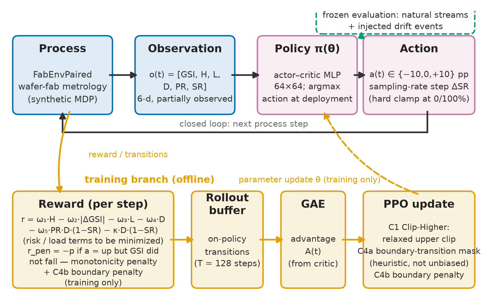

这是一个**晶圆厂缺陷抽检控制**的闭环仿真（FabEnvPaired，合成 MDP）：工艺过程（Process）产生缺陷，计量站抽检一部分晶圆得到观测 o(t) = [GSI, H, L, D, PR, SR] 六个维度——全局状态指标、命中率、负载、缺陷率、在制品、以及**当前抽检率 SR 本身**。策略网络（64×64 的 actor-critic MLP）每步决定把抽检率上调 +10、不变、还是下调 −10 个百分点。检得多，缺陷发现早（质量收益）；检得多，计量产能被挤占（成本）。这是一个天然的**风险-成本权衡**问题。

图的下半部分是训练回路：on-policy rollout（T=128 步）→ GAE 优势估计 → PPO 更新，加上从 LLM 强化学习算法 DAPO 迁移来的三个组件——**C1**（Clip-Higher，放松上裁剪）、**C4a**（边界转移掩蔽）、**C4b**（边界惩罚带）。部署配置 = PPO+C1+C4，训练 500k 步，称为"**旗舰**"（flagship）。

注意奖励框里的三行小字：ω₅·PR·D·(1−SR) 项、κ·D·(1−SR) 项、以及单调性罚项 r_pen。这张图是 **v2 更正版**——R7 收口时出的第一版漏画了这三项，事后在 `F1_correction.md` 里被我们自己抓出来作废重出。这个小插曲是整轮工作的缩影：**所有错误都会被登记，而不是被掩盖**。

## 1. 判决书：五项 P0 问题

2026-09-21 的严格评审（`DAPO_严格评审与重构建议_2026-09-21.md`）的结论很重："核心主张、实际实现、图表和统计解释之间存在实质断裂，大修后重审，不建议直接投稿。"五项致命问题：

- **P0-1（最致命）**：延迟鲁棒性实验是混杂的。旧协议把"当前抽检率 SR"也一起延迟了——这相当于让规则类对手"看不见自己的手"。评审复算发现，只要让对手保留 SR，旗舰对阈值规则的 +0.0476 优势**直接反转为 −0.0056**。论文当时标题级的"RL 唯一鲁棒优势"主张，建立在实验事故之上。
- **P0-2**：策略热图的 D/SR 两个轴标反了；事件图把 n=8 写成 n=32。
- **P0-3**：方法节的若干描述（同状态分支、新采样补满、critic 全样本更新）与代码实际不符。
- **P0-4**：C4a"无偏修正"的理论推导不成立。
- **P0-5**：PDF 缺局限性、结论、附录，还有未定义引用。

R1 的任务由此确定：**不是改措辞，而是用新证据重新审判每一条旧主张**。PLAN.md 定下六条铁律，其中三条塑造了整轮工作的气质——**零覆盖旧文件**（所有旧证据永久保留）、**本轮不动手稿**（先证据后叙事）、**统计纪律升级**（禁用 1.96 近似一律 t 分位数、配对交叉 bootstrap、Holm 多重校正、ns 不等于等效）。

## 2. 打地基：先承认随机数生成器是坏的（R0 → R1a）

评审 P0-1 背后还藏着一个更深的问题，R0 盘点时浮了出来：评测环境的事件流抽取依赖全局 RNG 状态。不同策略动作序列不同 → RNG 消耗不同 → **缺陷事件流在不同方法之间悄悄分叉**。8 个测试流种子里 7 个在 65–315 步内失步。也就是说，过去相当多"方法 A 比方法 B 好"的比较，两边跑的压根不是同一场考试。

修复方案叫 **FabEnvPaired**：事件流与策略完全解耦，所有方法在同一条扰动流上评测。这一步没有任何 flashy 的结果，但它是后面**每一个数字**的前提——而且付出代价：新旧环境数值不可混用，过去的结论必须全部重测。

## 3. 把"延迟"拆成四种：P0-1 的正面回答（R1a）

旧实验只有一个笼统的"延迟"。我们把它拆成机制上完全不同的四种：

- **DLY-METRO**：只延迟计量读数（你看到的是 k 步前的测量值）；
- **DLY-PROC**：延迟工艺状态（缺陷已经发生，但你不知道）；
- **DLY-ALL**：两者一起延迟（≈旧协议的修复版）；
- **EXEC-DLY**：只延迟**控制命令的执行**（动作发出了，设备 k 步后才动）。

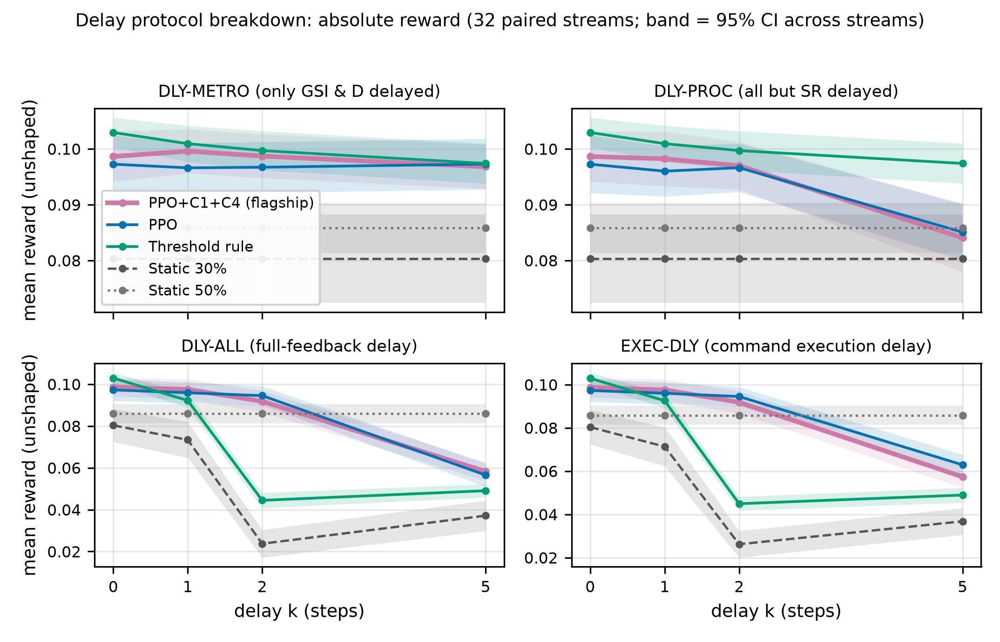

四张分图各讲一个故事。**DLY-METRO（左上）几乎平坦**：所有人对观测延迟都无感——这个任务里测量延迟根本不重要，旧稿拿它当卖点是无的放矢。**DLY-PROC（右上）反转了**：学习法（粉/蓝）随延迟下滑，而阈值规则（绿）稳在 0.098 附近，k=5 时规则明显更高——配对检验 −0.00272，p=0.039，**规则赢了**。**DLY-ALL（左下）所有人一起崩**。**EXEC-DLY（右下）是唯一的亮点**：阈值规则在 k=2 处断崖式塌到 0.045（它按"命令立即生效"设计，命令延迟后产生振荡），而学习方法优雅退化，k=5 时旗舰（粉）明显高于规则。

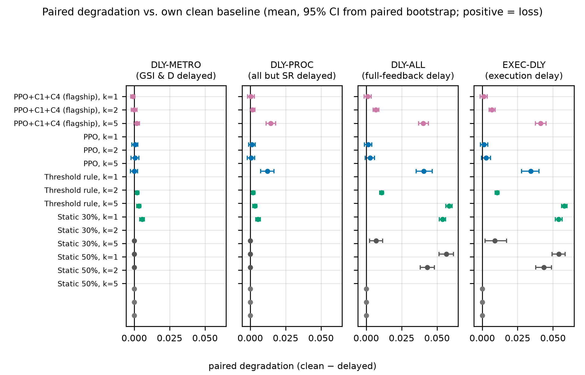

这张森林图换了个口径：不再比谁高谁低，而是看**每个方法相对自己的 clean 成绩掉了多少**（点越靠右掉得越多）。读法很直观：EXEC-DLY 面板里旗舰（粉色顶部三点）在各 k 值下退化都是最小的一档；而 DLY-PROC 面板里阈值规则的退化几乎为零、旗舰却掉了约 0.01。

**结论**："RL 有延迟鲁棒优势"这句全称命题死了，活下来的是一个精确得多的版本——**旗舰只对"命令执行延迟"有真实优势（+0.0469，32/32 流为正），对观测/过程延迟没有**。这个精确化后来在 D 阶段还要再被削一刀，暂且按下不表。

## 4. 把画反的图改回来：机制解释的真相（R1b）

P0-2 说热图轴画反了。实锤。旧 Fig.4(b) 把 D 和 SR 的轴标反，导致论文声称"策略主要由当前抽检率 SR 驱动"——一个对方法叙事很友好的结论（"它学会了反思自己的状态"）。修正后重画：

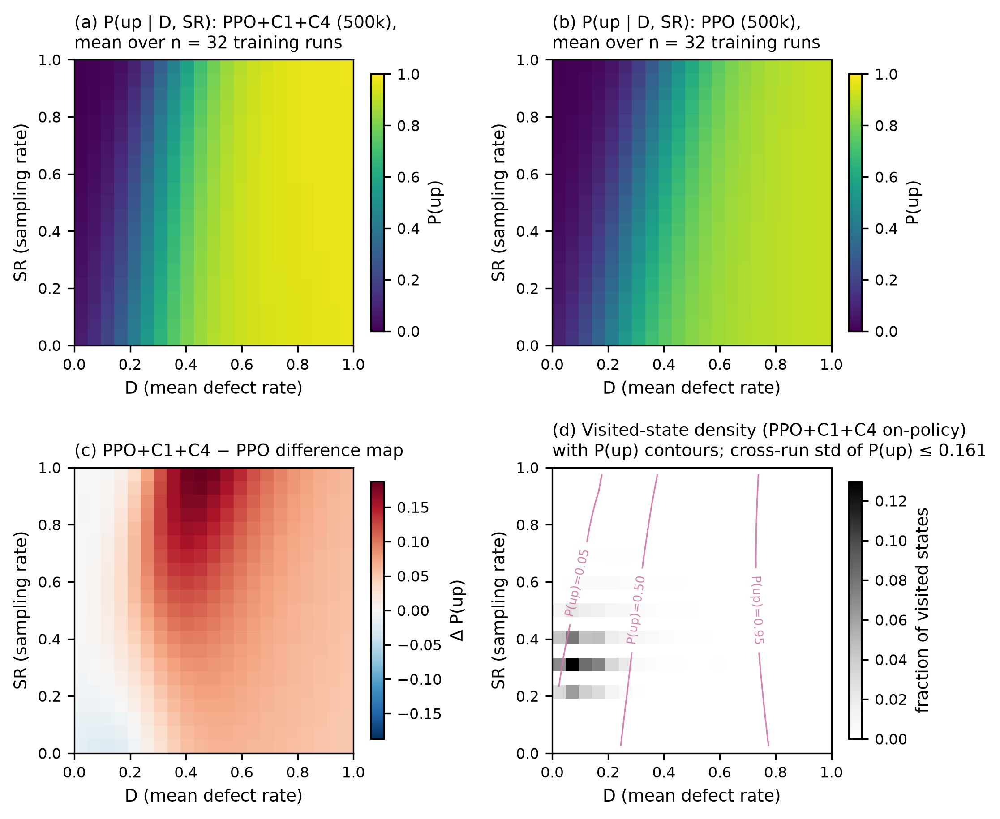

看 (a)(b) 两张热图的颜色结构：**色带是竖直的**——意味着 P(up) 几乎只随横轴 D（缺陷率）变化，与纵轴 SR 几乎无关。真实结论与旧稿相反：**策略由缺陷指示 D 主导**（锚点校验 P(up|D=1, SR=0)=0.961，32/32 run 通过）。(c) 差值图显示旗舰相对 PPO 的增益集中在中等 D 区域；(d) 的访问状态密度图则很诚实：策略实际访问的状态集中在低 D、SR 0.2–0.4 的一小条区域，热图其余大片区域是**外推**，看看就好。

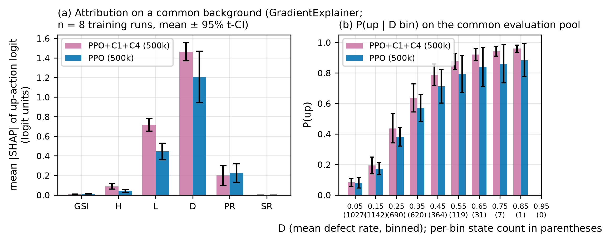

SHAP 分析也修了一个隐蔽错误：旧稿给两个方法各用各的背景样本，归因不可比。换成**共同背景**后 (a)：D 的归因强度一柱擎天（旗舰 1.464±0.094 vs PPO 1.206±0.262），L 次之，SR 几乎为零——与热图互相印证；(b) 的 P(up) 随 D 分箱单调上升，行为合理。机制叙事保住了，但内容被改写：不是"它反思自己的抽检率"，而是"**它确实学会了盯着缺陷信号行动**"。

## 5. 统计重算：旧结论的连锁塌方（R1c）

用新统计纪律把旧稿的检验全部重算一遍，结果是连锁塌方：

- "6/6 工况不劣"（H-CROSS）→ 双侧 t95 只剩 5/6，交叉 bootstrap 只剩 4/6；
- "截断全程≈0" → 截断率峰值 17.7–24.5%，集中在训练早期 12k–18k 步；
- 发现 8 条测试流历史上被**重复用于模型选择**（流复用偏差）。剔除后 H1 仍成立（p=6.6e-6），但旧稿"规则显著领先"的威胁性表述反而变成不显著（p=0.152）——**过去的恐慌和防御，一部分是复用流产生的伪影**。

## 6. 给 PPO 一次公平的机会：强对手登场（R3）

旧稿的对手是"默认超参 PPO"。评审的质疑很正当：赢了没调参的 PPO 算什么本事？于是我们做了两件花钱的事：**tuned PPO**（8 配置 × 3 种子 = 24 runs 正式调参，C8 配置胜出）和**规则家族调优**（阈值 THR、滞回 HYS、EWMA 在 dev 流上搜参），并且把成本对称登记：tuned PPO 调参花掉 12M 训练步，规则搜索折算 600k 步。

然后有了整轮工作最沉重的一张图：

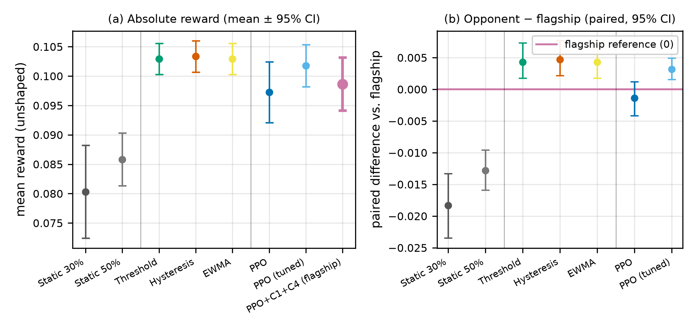

左图是绝对 reward，右图是"对手 − 旗舰"的配对差（点在 0 线以上 = 对手更好）。**HYS 0.1033 > THR 0.1029 > tuned PPO 0.1018 > 旗舰 0.0986**。右图里 Threshold、Hysteresis、EWMA、tuned PPO 四个点全部在零线以上，主比较族 Holm 校正后 p=0.0025/0.0069——**在干净的配对环境下，规则家族和调优后的 PPO 都显著反超旗舰**。静态基线（灰）依然垫底，RL 远好于不动脑子是真的；但"旗舰是最优配置"这个叙事，死了。

## 7. 解剖旗舰：四个组件到底谁在工作（R2/E1）

既然旗舰叙事死了，下一个问题是：四个组件各自的贡献是什么？16 次新训练，6 配置 × 8 种子：

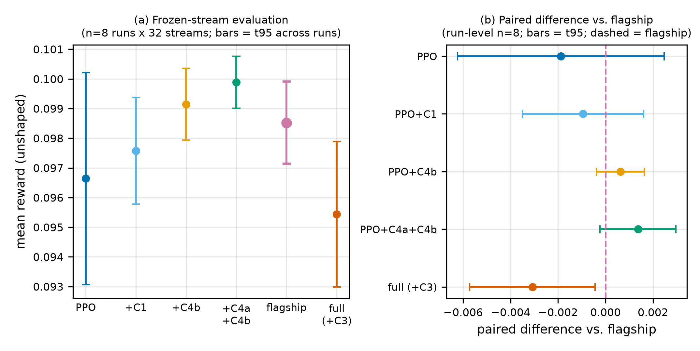

左图绝对值，右图"配置 − 旗舰"配对差。读右图：**PPO+C4b（黄）和 PPO+C4a+C4b（绿）的点都在零线右侧**——简化配置点估计不低于旗舰，但区间跨零，差异不显著；PPO（蓝）在左侧；最刺眼的是 **full(+C3)（橙）显著为负**（−0.0031，p=0.039）——C3 动态采样是有害的。结论排序：C4a+C4b 0.0999 ≥ C4b 0.0991 ≥ 旗舰 0.0985，**C4b 一个组件就够，C1 无独立增益，C3 帮倒忙**。

## 8. 十八种条件下的全面体检（R4）

9 方法 × 18 种扰动/噪声条件，21216 次评测：

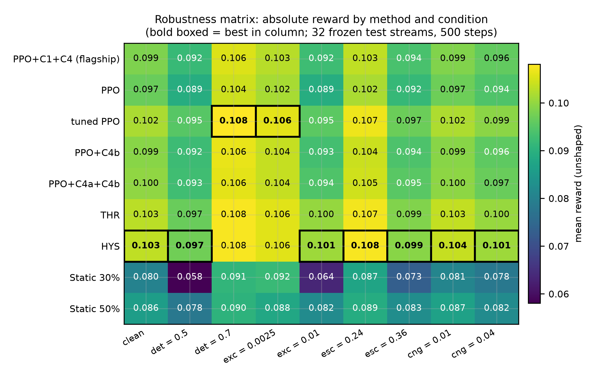

黑框标出每列最优。**HYS（滞回规则）拿走 7 列中的 6 列**，tuned PPO 拿走 2 列（det=0.7、exc=0.0025），旗舰在 17 个新评条件中**从未登顶**。整张矩阵黄得最稳定的是规则那一行。

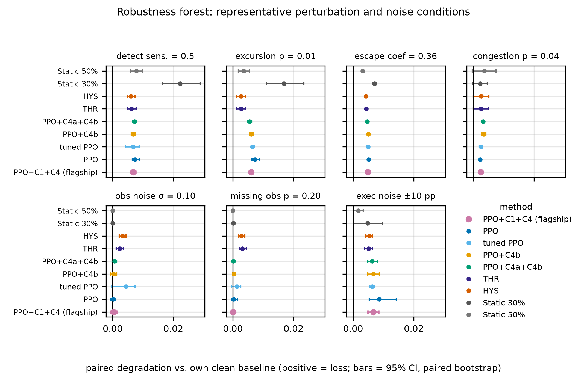

森林图看退化幅度（相对各自 clean，靠右=损失大），倒也不是全坏：obs noise、missing obs、exec noise 三个面板里旗舰（粉）的退化都是最小的一档——**学习方法对观测噪声和执行噪声确实更钝感**。规则赢绝对水平，学习法赢抗噪韧性，这是权衡而非溃败。

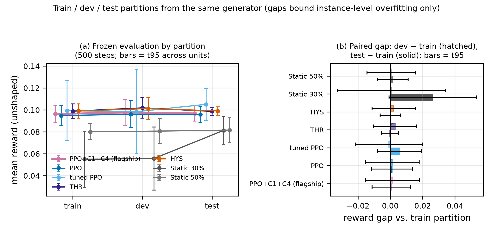

这张图回答"是不是过拟合测试流"：train/dev/test 三个分区的配对 gap 几乎全部贴零。结论：**没有实例级过拟合**——旗舰输给规则不是因为它背题，而是因为它真的就这个水平。

## 9. 把模型选择关进交叉验证的笼子（R5）

流复用的教训让我们换了评估范式：50 个场景组做分组五折交叉验证（80 runs），配置选择只看折内，折外（OOF）评测。

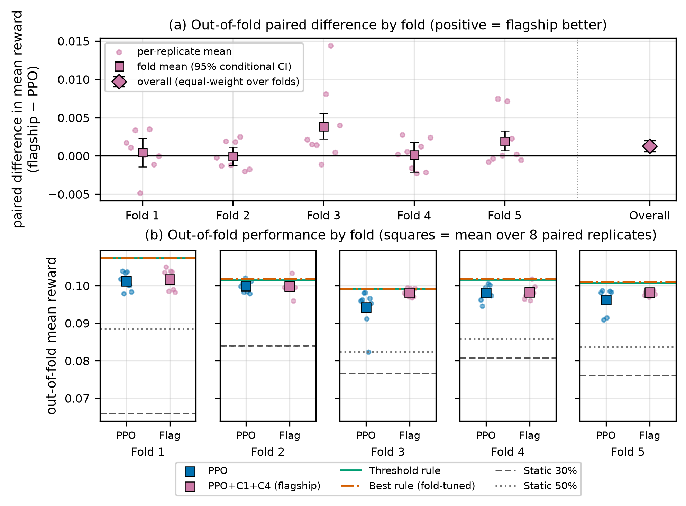

(a) 旗舰−PPO 逐折配对差：五折均值都在零附近晃，总效应 +0.0013（CI [+0.0005, +0.0020]，4/5 折为正）——**对默认 PPO 的组件增益在严格 OOF 口径下勉强存活**，这是旗舰为数不多的好消息。但 (b) 每折里的两条横线（绿=THR、橙=折内调优的最优规则）始终压在两个学习法的方块上方——**对规则，5/5 折为负**。

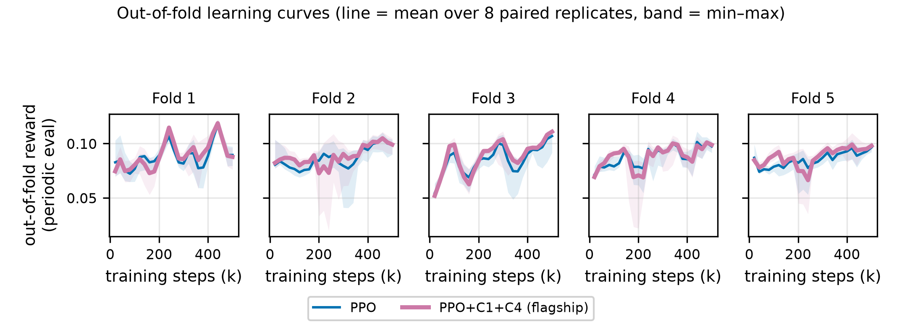

逐段 OOF 学习曲线：粉（旗舰）与蓝（PPO）在大多数折里纠缠在一起，旗舰偶有小优。视觉直观结论与 (a) 一致：组件有效，但效应量很小。

## 10. 换个维度：事件响应的时间竞赛（R6）

reward 是平均分，事件响应是"缺陷漂移发生后多快反应过来"。协议升级为 3×3 九宫格（3 种漂移幅度 × 3 种持续时间）× 双分支（注入/不注入漂移，用不注入的分支测误报），并用 Kaplan–Meier 生存分析处理"窗口内未响应"的删失。

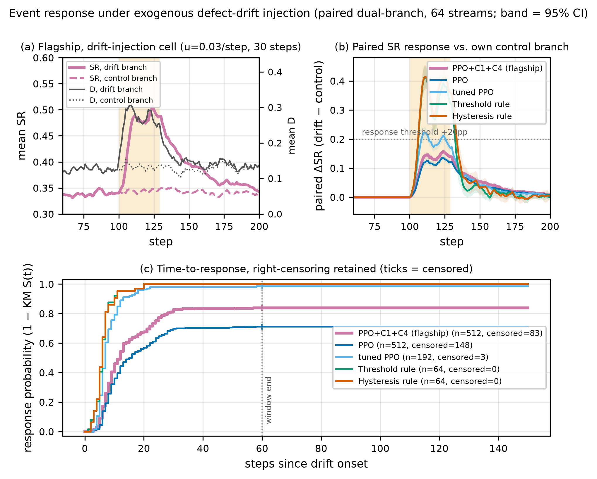

(a) 旗舰在漂移注入窗口（黄底）内 SR 紧随 D 拉起——响应行为真实存在。(b) 各方法的配对 ΔSR 响应曲线：滞回规则（橙）冲得最高（+0.4），旗舰（粉 +0.14）高于 PPO（蓝 +0.11）但远低于规则。(c) KM 曲线：横轴漂移后步数，纵轴累计响应概率。规则秒响应（删失=0），tuned PPO 几乎全响应（删失 3/192），**旗舰 83/512 删失（响应率 0.838）、PPO 148/512（0.71）**——旗舰显著好于 PPO，但天花板比规则低。

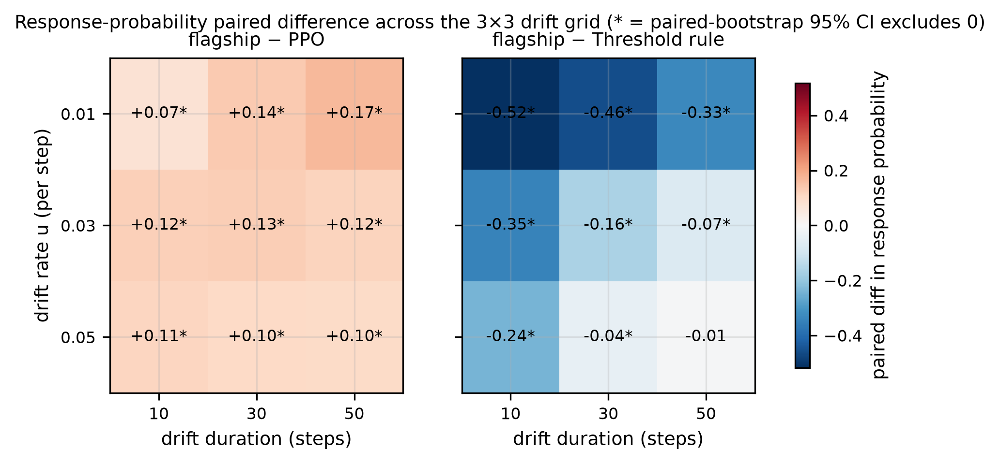

这是 R6 最凝练的一张图，左红右蓝：**对 PPO，旗舰 9/9 格显著为正；对阈值规则，旗舰 8/9 格显著为负**。同一个方法，参照系一换，结论整个翻转。这张图大概是整轮工作"相对性"主题的最佳插图。

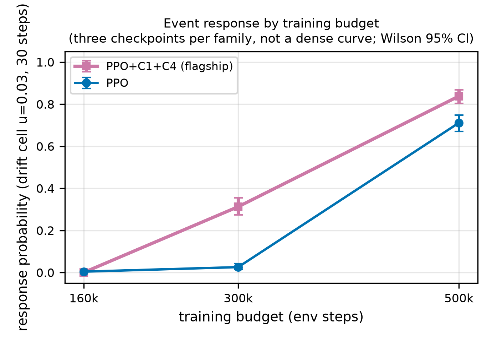

事件响应随训练预算的涌现：160k 时两者都是 0；**300k 时旗舰 0.31 而 PPO 只有 0.03**——组件让响应早涌现了一档；500k 时 PPO 也追到 0.71。这是"预算门控"主张的三点证据（后来 T2 会把它加密成连续曲线）。

## 11. 收口与自我清算（R7 + W 批）

R7 把所有结论汇成主表（`data_R1/v9_main_table.csv`，10 方法 × 12 列，逐格溯源）和 15 张候选图（即本文全部插图）。W 批做纯文档清算：登记全部种子重叠（O1–O4），建立 11 个检验族台账（E1 的五条显著全部不抵抗 Holm 校正），逐条修正 15 条主张表述。至此原计划 R0–R7 完成。但有几个窟窿不补不踏实，于是有了追加的 T 系列。

## 12. 追加审判（T1–T4）

**T1 全新流复测**：最后一个辩护是"也许结论只是过拟合那 32 条老流"。用真正全新的流（种子 600042–600073）全交叉评测：**旗舰 0.0999 < tuned PPO 0.1025（Holm-p=3e-6）< THR/HYS，原方向复现**。辩护无效。

**T2 密集预算曲线**（40 runs × 20 checkpoint）：把"预算门控"从三个点加密成连续曲线。

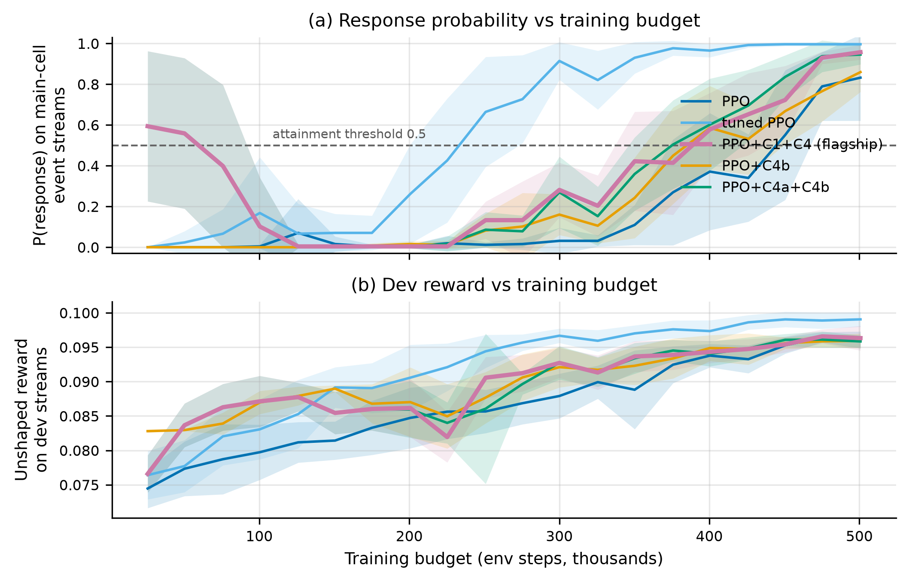

(a) 响应概率 vs 预算：意外收获是**非单调瞬态**——旗舰早期响应率冲到 0.6，100–225k 反而塌缩回零，之后才稳步爬升（早期是假响应，被训练动力学自己清掉了）。更关键的：虚线（达标 0.5）处，**tuned PPO（浅蓝）约 251k 最早跨过**，旗舰/C4b 要到 400k。"旗舰早一档"只对默认 PPO 成立。(b) dev reward 曲线上 tuned PPO 全程压着其他方法。

**T3 部分观测**（O1，24 runs）：真实产线里缺陷率 D 只能从抽检数据估计，不能直接观测。

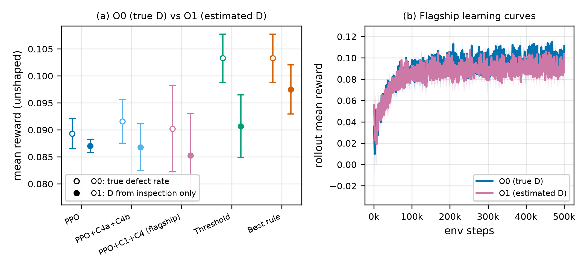

(a) 空心=真实 D（O0）、实心=估计 D（O1）：切到 O1 后所有学习法都下滑，而规则（Threshold/Best rule）实心点仍稳在 0.097+，**旗舰显著落后最优规则 −0.0122（Holm-p=0.016），旧 checkpoint 零样本迁移退化 −0.0169**。(b) 学习曲线显示 O1（粉）收敛水平低于 O0（蓝）。观测质量是 RL 方案的硬约束。

**T4 tuned 预算下再做消融**（32 runs）：也许组件增益要配上好超参才显现？

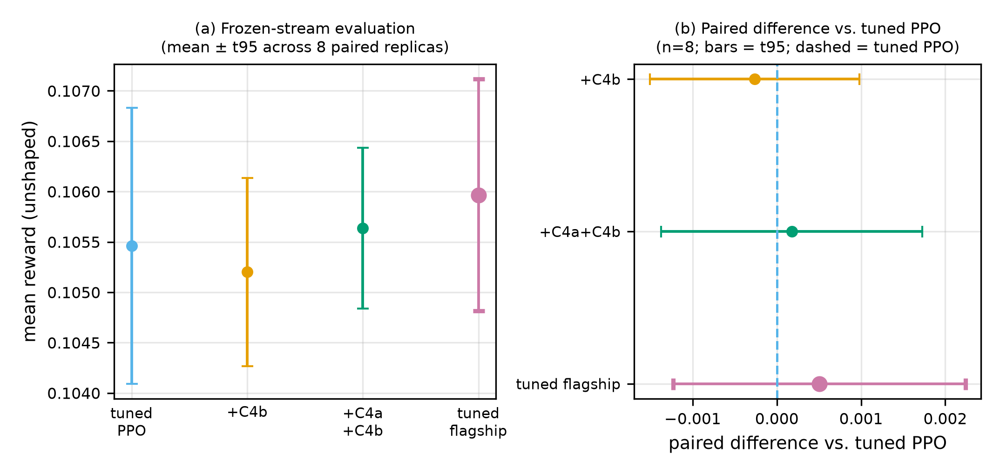

没有。(b) 三条配对差区间全部跨零：组件增量 +0.0005（Holm-p=1.0），大约是调参本身增益（+0.0045）的 1/9。**在调优预算下，组件的贡献淹没在噪声里。**

## 13. 最后一刀：EXEC-DLY 优势到底是不是真的（D 阶段）

至此旗舰只剩一块完整的阵地：EXEC-DLY 执行延迟优势。D 阶段问了一个致命的问题：这个优势是 RL 的前瞻智能，还是**对手太笨**——规则按"命令立即执行"设计，当然会被命令延迟打懵？于是我们构造了**延迟感知滞回规则 HYS-DA**：在规则里显式补偿命令延迟。

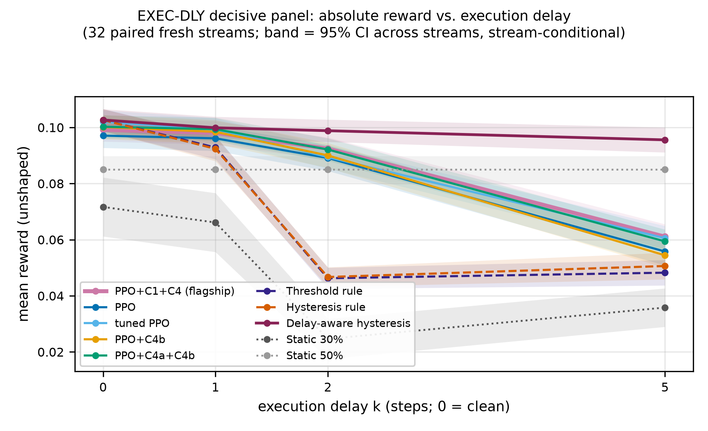

结果一目了然：**HYS-DA（暗红实线）在 k=0 到 k=5 全程几乎水平（0.098→0.096）**，而所有学习方法（粉/蓝/浅蓝/黄/绿）随 k 稳定下滑，k=2 起全部落到 HYS-DA 下方。配对检验：k=2 旗舰落后 −0.0064（Holm-p=1e-6），k=5 落后 −0.0345。**一旦对手也知道命令会延迟，旗舰的优势消失并反转。**

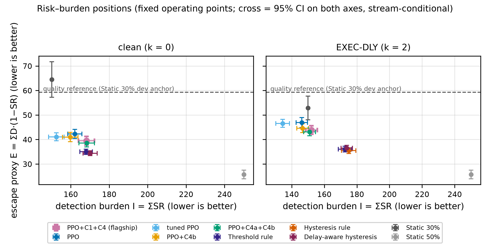

这张图解释了为什么。横轴检测负担 I（ΣSR，越左越好），纵轴逃逸代理 E（越下越好）。k=2 面板里，HYS-DA/THR（暗红/紫）占据右下（高负担、低逃逸），旗舰（粉）占据左上（低负担、高逃逸）——**旗舰不是"更好"，只是选了一个"少检、漏检多"的工作点**；reward 公式恰好在这个仿真器里奖励了它。这是整轮工作最后一个旧主张的死亡证明，同时也是一个真实的科学发现：RL 学到的是奖励函数定义的工作点，而不是人类以为的"聪明"。

## 14. 清点战场：叙事决策（N 阶段）

所有证据摆上桌后，`narrative_decision_memo.md` 评估了三条路线：

- **(a) 维持旗舰叙事**：论证闭环已跑完且**未闭环**——没有任何一个维度上旗舰显著优于 C4a+C4b 简化配置；
- **(b) 双配置叙事**：旗舰+简化版并立——"多维稳健"那半句没有证据；
- **(c) 接受消融结论（推荐）**：叙事收缩为"**C4 族边界处理（C4b 为核心）是有效组件；C1 无独立增益；调参与规则是强对手**"，方法节保留 PPO+C1+C4 作为工程兼容候选。这条路线与评审结语、独立重构工作区 dapo_c_rw 的结论三方收敛。

**幸存主张（4 条，全部带口径）**：免测试时调参的部署形态；EXEC-DLY 优势（限定"相对不补偿命令延迟的控制器"）；响应-误报权衡的中间工作点；预算门控下事件响应早于默认 PPO 一档（探索性）。

**撤回主张（8 条）**：测量延迟决定性优势；C4a 纯无偏；C3 负结果的全称表述；截断全程≈0；H-CROSS 6/6 不劣；热图"SR 主导"/SHAP 认证机制；clean 显著领先规则的全称表述；"500k 与 PPO parity"。

## 15. 这轮工作到底留下了什么

216 次训练、数万次评测之后，论文的地基换了。表面上看这是一次失败——旗舰没有赢；但换一个角度，R1 交付了三样比单个 SOTA 数字值钱得多的东西：

1. **一套被修复的测量基础设施**：FabEnvPaired 配对环境、延迟四协议、分组 CV、KM 事件协议、检验族台账——以后这个方向上的任何结论都有了可信赖的秤；
2. **一张诚实的组件地图**：C4b 是承重墙（删掉它会引发截断率 0→54%、事件响应率 92%→28% 的级联崩溃，这在 R2 会被再次独立验证），C1/C4a 无独立增益，C3 有害；
3. **一个可辩护的论文新形态**：从"我们提出了更强的 RL 方法"退到"我们系统评估了这组组件，画清了它何时工作、何时不工作"——后者正是 R2_deployment 重写新论文的起点。

遗留问题也如实登记在案：真正全新的端到端测试（新训练种子×新流）未做；密集预算曲线还要加密；O1 的工业语义待深化；以及最重要的——叙事路线 (c) 被推荐但**尚未最终拍板**，手稿一个字还没动（这是铁律）。

如果要给同行一句可带走的话，大概是：**评审指出的最大问题往往不是结论错了，而是测量错了；修好秤之后，你要有勇气把新读数原样登出来。**

---

### 附：本文图表索引

| 图 | 阶段 | 一句话 |
|---|---|---|
| v9_fig1_system_v2 | R7 | 系统与训练回路（v2 更正版） |
| v9_fig_delay_split / delay_degradation | R1a | 延迟四协议：只有 EXEC-DLY 是真优势 |
| v9_fig_policy_map / shap_common | R1b | 策略由 D 主导，非 SR |
| v9_fig_main_result | R3 | 规则与 tuned PPO 反超旗舰（核心暴击） |
| v9_fig_ablation | R2/E1 | C4b 够，C1 无增益，C3 有害 |
| v9_fig_robustness_matrix / forest / generalization | R4 | 规则横扫矩阵；学习法抗噪；无过拟合 |
| v9_fig_cv5 / cv5_curves | R5 | 对 PPO 勉强为正，对规则 5/5 负 |
| v9_fig_events / events_grid / events_budget | R6 | 响应真实存在但天花板低于规则；预算门控 |
| v9_fig_budget_dense | T2 | tuned PPO 251k 最早达标；非单调瞬态 |
| v9_fig_o1 | T3 | 部分观测下规则稳赢 |
| v9_fig_tune_abl | T4 | tuned 预算下组件增量≈0 |
| v9_fig_decisive_delay / risk_burden | D | HYS-DA 反转 EXEC-DLY；旗舰是工作点选择 |

数据底表：`data_R1/`（主表 `v9_main_table.csv`、主结果检验 `v9_main_result_tests.json`、消融 `v9_e1_*.csv`、延迟 `v9_delay_split_paired.csv`、CV `v9_cv5_*`、预算 `v9_budget_stats.json`）。